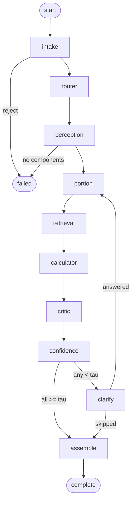
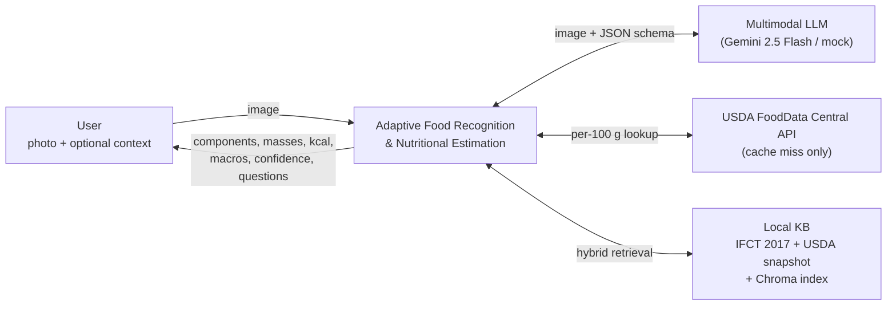
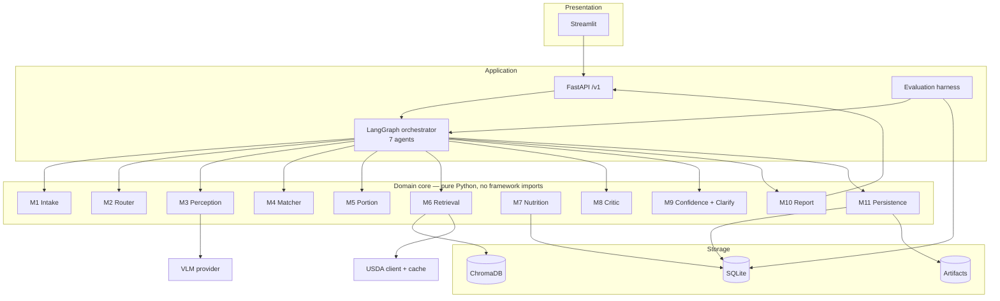
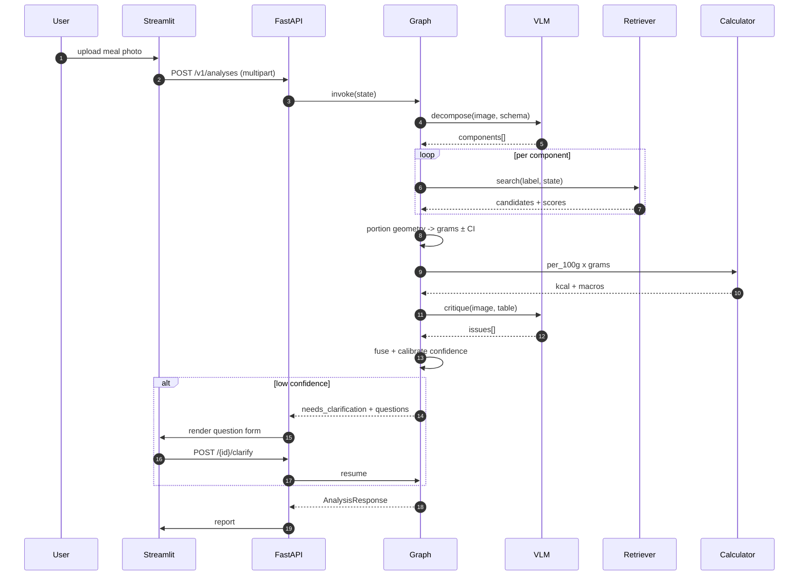

# Architecture

**Adaptive Food Recognition and Nutritional Estimation Using Multimodal AI** — Team The Invincibles, GVP College of Engineering (CSE).

This is the consolidated architecture reference: how the system is shaped, how a request moves through it, what it is built on, and what every stage is contractually allowed to output. Deep detail lives in `docs/` (links at the end).

---

## 1. Multi-agent graph



Resumability comes from LangGraph checkpoints: a clarification round trip re-enters at `portion` and re-runs the downstream tail. Round budget is 2, enforced by `MAX_ROUNDS`.

---

## 2. The problem the architecture solves

Nutrition from a photo is `identity × mass` summed over `N` components. Existing apps collapse a plate into a single dish label and one guessed serving, so error comes from four places:

| Error source | Countermeasure in this architecture |
|---|---|
| One dish label for a mixed plate | Component decomposition (M3) with bounding regions |
| Guessed serving size | Scale-anchored geometry → volume → mass, with an interval (M5) |
| Model-invented calories | Retrieval-grounded values + arithmetic outside the LLM (M6, M7) |
| Confidently wrong output | Fused, calibrated confidence + selective clarification (M8, M9) |

---

## 3. Context (C4 L1)



**External dependencies and their failure mode**

| Dependency | If unavailable |
|---|---|
| VLM provider | `MOCK_MODE=1` deterministic fixtures keyed by image hash |
| USDA API | local index only, `stale_kb` flag |
| Chroma index | rebuild via `python -m app.rag.build_index`; if it is still missing the request degrades to live USDA lookup, then `matched=False` (the index is never authoritative) |
| Network entirely | full demo still works (mock provider + local KB) |

---

## 4. Containers (C4 L2)



**Why the core is framework-free:** M1–M10 must be testable without a graph, a network, or a database. LangGraph wires them; it does not contain them. This is also what makes the 12‑week plan survivable — if orchestration slips, the pipeline still ships.

---


---


## 5. End-to-end sequence



---

## 6. Confidence model (summary)

```
s_ident, s_retr, s_port, s_crit, s_img, s_state, s_cover   ∈ [0,1]

raw = 0.28·s_ident + 0.20·s_retr + 0.18·s_port
    + 0.14·s_crit  + 0.08·s_img  + 0.07·s_state + 0.05·s_cover

confidence = isotonic_calibrate(raw)        # fitted on dev split

Hard caps apply before calibration (`matched=False → ≤0.25`, critic veto `→ ≤0.40`, severe blur `→ ≤0.55`).

Meal confidence = `coverage^0.5 × Σ w_i·c_i`, mass-weighted. Totals get P10/P50/P90 by Monte-Carlo propagation of log-normal mass error (fixed seed → reproducible reports).

Full derivation: `docs/06-confidence-and-clarification.md`.
```

Hard caps apply before calibration (`matched=False → ≤0.25`, critic veto `→ ≤0.40`, severe blur `→ ≤0.55`).

Meal confidence = `coverage^0.5 × Σ w_i·c_i`, mass-weighted. Totals get P10/P50/P90 by Monte-Carlo propagation of log-normal mass error (fixed seed → reproducible reports).

Full derivation: `docs/06-confidence-and-clarification.md`.

---

## 7. Knowledge base

The system relies on a **dual-index retrieval** strategy that matches the two granularities of the data:

- **Ingredient-level** (IFCT 2017 + USDA snapshot) – the primary source of truth. Every food record is versioned (`kb_version`) and stored in SQLite; the vector index is derived from these rows, never written directly.
- **Composite-level** (dish recipes) – derived from ingredient records via recipe fractions computed by the same M7 arithmetic used at inference, preserving provenance at both granularities.


### Related work (brief)

- **IFCT 2017** – Indian food composition tables (528 foods, ~150 nutrients per 100 g). Provides the ground‑truth ingredient layer.
- **USDA FoodData Central** – public domain nutrient database; used as a fallback when the local KB is missing.
- **Dual‑index retrieval** – hybrid BM25 + vector search (Chroma + BM25) with RRF fusion; this is the key data decision that enables both ingredient‑level and composite‑level lookups.
- **Adaptive routing** – T0/T1/T2 tiers based on quality, component count, and scene complexity; this is the core control plane.

---

## 8. Tech stack

### What it does

### Tech Stack

- **Language:** Python 3.11 / 3.12
- **Backend:** FastAPI, Uvicorn
- **Frontend:** Streamlit
- **AI Orchestration:** LangGraph
- **Vision Models:** Gemini 2.5 Flash (Groq and Ollama optional)
- **Embeddings:** BAAI/bge-small-en-v1.5
- **Reranking:** ms-marco-MiniLM-L-6-v2
- **Vector Database:** ChromaDB
- **Lexical Search:** BM25s
- **Database:** SQLite
- **Image Processing:** Pillow, OpenCV
- **Data Processing:** NumPy, Pandas, Scikit-learn
- **Validation:** Pydantic v2
- **Testing & Code Quality:** Pytest, Ruff, Mypy
---

## 9. Interfaces

### API (`/v1`)

| Method | Path | Notes |
|---|---|---|
| POST | `/v1/analyses` | multipart image + optional context; returns `AnalysisResponse` |
| GET | `/v1/analyses/{id}` | replay a frozen report |
| POST | `/v1/analyses/{id}/clarify` | answers, resume graph, max 2 rounds |
| PATCH | `/v1/analyses/{id}/components/{ord}` | correct identity/mass, recompute, log feedback |
| POST | `/v1/analyses/{id}/components` | add a missed component |
| DELETE | `/v1/analyses/{id}` | delete analysis + artifacts |

| Method | Path | Notes |
|---|---|---|
| GET | `/v1/foods/search` | KB search for manual correction |
| GET | `/v1/meta`, `/healthz` | provider, KB version, dependency health |
---

## 10. Non‑functional targets

| Dimension | Target |
|---|---|
| Latency T1 | p50 ≤ 8 s, p95 ≤ 20 s |
| Cost | ≤ $0.01 per analysis (T2) |
| Calorie error | MAPE ≤ 18 %, MAE ≤ 90 kcal on mixed plates |
| Component F1 | ≥ 0.80 at IoU 0.5 |
| Calibration | ECE ≤ 0.10; selective accuracy ≥ 0.88 at conf ≥ 0.8 |
| Offline | full pipeline with `MOCK_MODE=1` |
| Privacy | local‑only images, 30‑day retention, one‑click delete |


## 11. References (papers)

- **IFCT 2017** – Indian Food Composition Tables (NIN Hyderabad). Primary ingredient source.
- **USDA FoodData Central** – Public domain nutrient database; used as fallback when local KB is missing.
- **Dual‑index retrieval** – Hybrid BM25 + vector search (Chroma + BM25) with RRF fusion; key design decision.
- **Adaptive routing** – T0/T1/T2 tiering based on quality, component count, and scene complexity; reduces unnecessary VLM calls.
- **Confidence calibration** – Isotonic calibration on dev split; ECE ≤ 0.10 target.
- **MOCK_MODE** – Deterministic fixtures keyed by image hash; enables offline reproducibility.

---

*All components are designed to be testable without a graph, a network, or a database. The system is built for offline operation on a laptop with 8 GB RAM, and the full pipeline works with `MOCK_MODE=1` (deterministic fixtures) while still supporting live USDA lookup when the local index is missing.*
