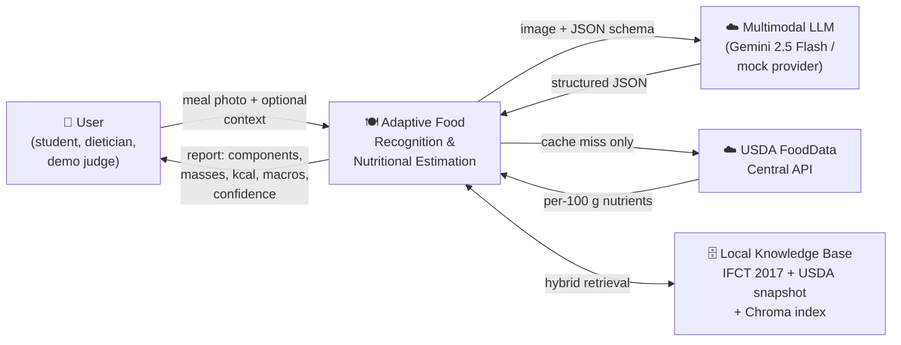
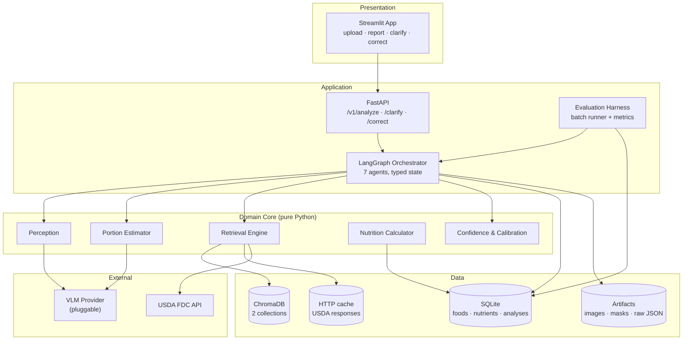
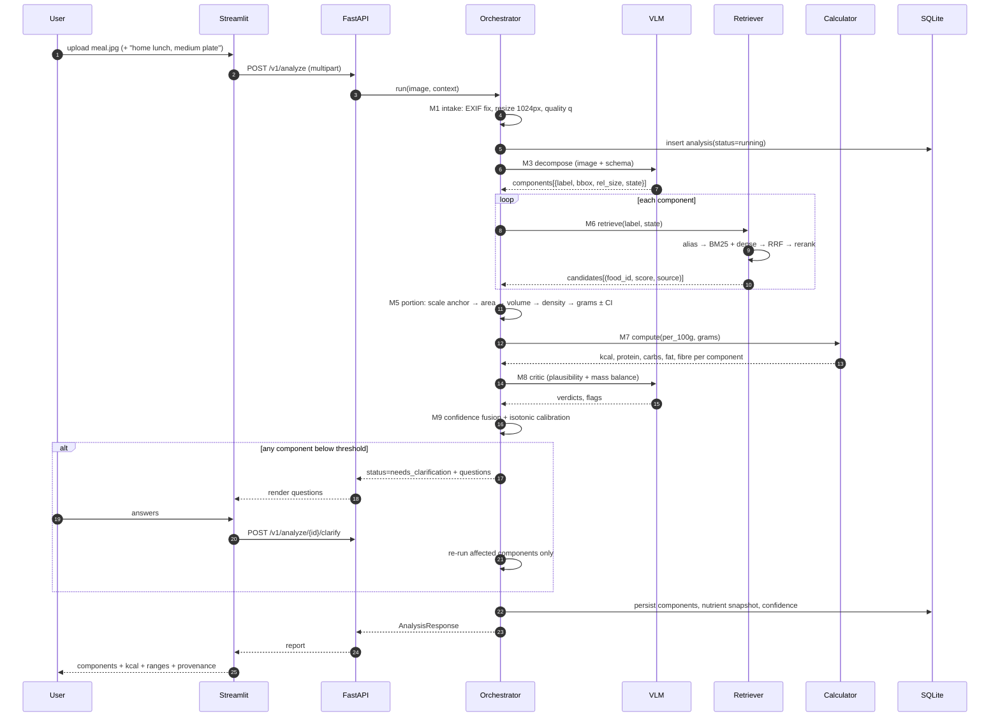
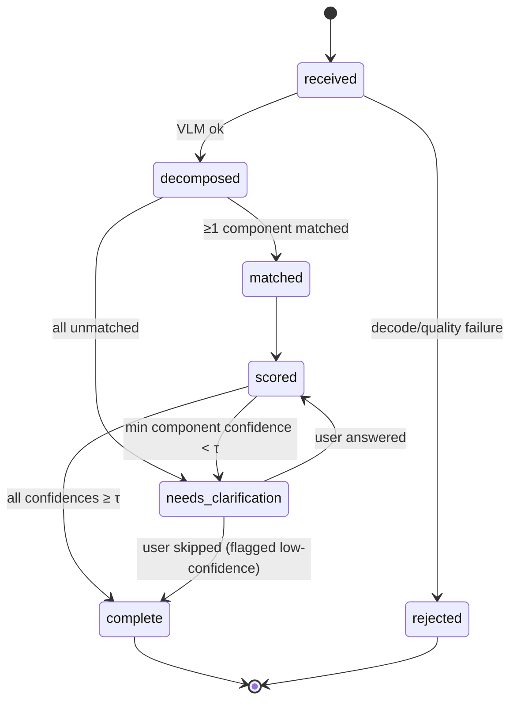

# 01 — System Architecture

## 1. Problem framing

A meal photo contains **N ≥ 1 discrete physical components** (rice mound, dal bowl, two chapatis, a spoon of pickle). Nutrition is a linear function of *identity × mass*, so error has two independent sources:

| Error source | Typical failure in existing apps | This system's countermeasure |
|---|---|---|
| **Identity** — whole dish labelled as one item | "Chicken biryani, 550 kcal" when the plate is 60 % rice, 20 % chicken, 15 % raita | Component decomposition + per-component retrieval |
| **Mass** — user guesses "1 serving" | ±50 % caloric error from a single mis-tap | Scale-anchored volumetric estimation with confidence intervals |
| **Grounding** — LLM states a calorie number from memory | Numbers that cannot be audited and drift between runs | Retrieval-grounded values + deterministic arithmetic |
| **Silent failure** — model is wrong and confident | User trusts a 40 % error | Calibrated confidence + targeted clarification |

## 2. Goals and non-goals

**Goals**

- **G1** Identify 3–8 components in a mixed meal with bounding regions and canonical food names.
- **G2** Estimate each component's mass in grams, with an explicit uncertainty range.
- **G3** Ground every nutrient value in a cited database record (IFCT 2017 or USDA FDC ID).
- **G4** Produce a calibrated confidence per component and per meal, and ask a question only when the expected error reduction justifies it.
- **G5** Emit an interpretable report: what was seen, how much, where the number came from.
- **G6** Run on a laptop at demo speed (p50 < 8 s) and near-zero cost.

**Non-goals (explicitly out of scope for FYP-1)**

- Medical or clinical dietary advice; any output is guidance, not prescription.
- Complete micronutrient coverage (we carry the nutrients the source DB provides; the UI highlights calories + protein/carb/fat/fibre).
- Video / multi-frame tracking, restaurant menu OCR matching, barcode scanning.
- Multi-tenant auth, payments, cloud deployment at scale.

## 3. Design principles

| # | Principle | Consequence in the design |
|---|---|---|
| **P1** | *LLM proposes, database disposes* | The VLM emits **names, regions and relative sizes only**. It never emits calories. Nutrient numbers come from `food_nutrient` rows. |
| **P2** | *Deterministic arithmetic* | `kcal = Σ (per_100g × mass_g / 100)` lives in pure Python, unit-tested against hand-computed fixtures. |
| **P3** | *Confidence is measured, not self-reported* | Never trust a model's "confidence": 0.9. Fuse self-consistency, retrieval margin, portion plausibility and verifier verdicts, then **isotonic-calibrate** on the gold set. |
| **P4** | *Adaptive cost* | Trivial images must not pay for the full agent graph. Routing decides how much compute a photo deserves. |
| **P5** | *Provenance everywhere* | Every displayed number resolves to `(food_id, source, fdc_id/ifct_code, grams)` and is serialised in the API response. |
| **P6** | *Degrade, never crash* | Every external dependency (VLM, USDA API, embedding model) has a fallback path. Missing USDA key → local index only. Missing VLM key → mock provider. |

## 4. What "adaptive" means here

The title's *adaptive* is realised on three independent axes. Each is a testable claim in the evaluation.

| Axis | What adapts | Mechanism |
|---|---|---|
| **A1 — Compute adaptivity** | How much model work a photo receives | Scene router assigns Tier 0/1/2 (§6) |
| **A2 — Retrieval adaptivity** | Where a nutrient value is sourced from | Local hybrid index → live USDA FDC → user-provided custom food |
| **A3 — Interaction adaptivity** | Whether and what we ask the user | Clarification engine ranks candidate questions by expected error reduction (§06 doc) |

## 5. Context diagram (C4 Level 1)



## 6. Container view (C4 Level 2)



## 7. Adaptive routing tiers

The router runs **before** any expensive call, using image statistics plus a single cheap classification prompt (skippable if the VLM call is cheap enough — with Gemini Flash we merge routing into the main call and use its `scene_complexity` field).

| Tier | Trigger | Pipeline executed | VLM calls | Target latency | Target cost |
|---|---|---|---|---|---|
| **T0 — Simple** | One dominant food, sharp, no occlusion, `component_count ≤ 1` | decompose → match → portion → compute | 1 | 3–5 s | ~$0.001 |
| **T1 — Mixed plate** | 2–8 components, adequate light | decompose → crop verification → match → portion → critic → compute | 2–3 | 6–12 s | ~$0.004 |
| **T2 — Ambiguous** | Occlusion, blur, unknown cuisine, `component_count > 8`, or critic veto | T1 + detector-assisted localisation + 2× self-consistency + clarification | 4–5 | 12–25 s | ~$0.010 |

Routing signals (all available cheaply):

1. `laplacian_variance` (blur), `mean_luma` (exposure), `exif` presence → image quality score `q ∈ [0,1]`.
2. VLM `scene_complexity` ∈ {simple, mixed, cluttered} and `component_count`.
3. History: if the user corrected the last analysis heavily, bias upward one tier for that session.

Router decision:

```
tier = T0 if q >= .75 and count <= 1
     = T2 if q <  .45 or count >  8 or scene == cluttered
     = T1 otherwise
```

## 8. End-to-end data flow



## 9. Analysis lifecycle



`status` is stored on the `analyses` row and is the single source of truth for the UI.

## 10. Non-functional budgets

| Budget | Target | Measured by |
|---|---|---|
| Latency p50 / p95 (T1) | ≤ 8 s / ≤ 20 s | `latency_ms` per analysis, evaluation harness |
| Cost per analysis | ≤ $0.01 (T2), ≤ $0.005 (T0/T1) | token accounting per provider call |
| Calorie MAE (mixed plates, n≥60) | ≤ 90 kcal or ≤ 18 % MAPE | §08 evaluation |
| Component F1 | ≥ 0.80 at IoU ≥ 0.5 | §08 evaluation |
| Expected Calibration Error | ≤ 0.10 | §08 evaluation |
| Cold start (index + models) | ≤ 60 s | startup log |
| Offline capability | Full pipeline with `MOCK_MODE=1` | CI smoke test |

## 11. Architecture decision records

| ID | Decision | Alternatives rejected | Why |
|---|---|---|---|
| ADR-001 | VLM returns **structured JSON** via provider-native schema enforcement, not free text parsed with regex | Prompt-and-parse | Regex parsing fails ~5–10 % of calls and is untestable |
| ADR-002 | Nutrition computed in Python from DB rows, VLM never emits kcal | "Ask the LLM for calories" | Violates G3/P1; unauditable and unpublishable |
| ADR-003 | Hybrid retrieval (BM25 + dense + RRF) over dense-only | Dense-only (simpler) | Food names are rare proper nouns ("koora", "pappu"); dense-only recall collapses on exact-name queries |
| ADR-004 | ChromaDB over FAISS/pgvector | FAISS (no metadata filters), pgvector (ops overhead) | Metadata pre-filtering on `state`/`category` is required; Chroma is file-based |
| ADR-005 | LangGraph over hand-rolled `if/else` or CrewAI | CrewAI (opaque), custom (no checkpointing) | Explicit graph = diagram in the report; checkpointing enables clarification resume |
| ADR-006 | SQLite for both metadata and eval results | Postgres from day 1 | Zero ops for demo; DDL kept Postgres-compatible so a migration is a connection-string change |
| ADR-007 | Mock provider is a **first-class** implementation, not a test double | Skip until key arrives | Team has no key yet (confirmed); whole pipeline + UI must be demoable offline |
| ADR-008 | Persist the **raw VLM response** per analysis | Store only parsed output | Needed to debug prompt regressions and to re-parse old analyses after schema changes |

## 12. Deployment topology

**Development / demo (single laptop, Windows or macOS)**

```
streamlit run app/ui/streamlit_app.py     → :8501
uvicorn app.api.main:app --reload         → :8000
chroma persist dir ./data/chroma
sqlite file       ./data/app.db
artifacts         ./data/artifacts/{analysis_id}/
```

**Fallback demo mode (no network at all)**

`MOCK_MODE=1` + seeded fixtures in `data/fixtures/`. The mock provider returns deterministic decompositions keyed by image hash, so the demo is reproducible and cannot fail in front of a jury.

**Later (optional, FYP-2)** — Docker Compose with the same three processes; no code change beyond env vars.
