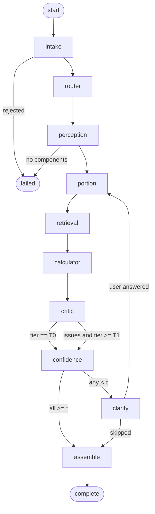

# 02 — Module Design and Multi-Agent Orchestration

Every module below is a Python package under `app/core/` with a **pure function or class-level entry point**, no framework imports. Agents in `app/agents/` are thin wrappers that adapt these modules to the LangGraph state. This keeps 90 % of the logic unit-testable without a graph, a network or a database.

---

## 1. Module map

| ID | Module | Package | Responsibility | LLM? |
|---|---|---|---|---|
| M0 | Config & provider abstraction | `app/core/config.py`, `app/providers/` | Env loading, model registry, structured-output wrapper, retries, token accounting | — |
| M1 | Image intake & quality gate | `app/core/intake.py` | Decode, EXIF orient, resize, quality score, perceptual hash | no |
| M2 | Scene router | `app/core/router.py` | Tier selection T0/T1/T2, per-image compute budget | no |
| M3 | Perception | `app/core/perception.py` | Component decomposition, bbox, relative size, cooked state, cuisine prior | **yes** |
| M4 | Food matcher | `app/core/matching.py` | Alias normalisation, canonicalisation, cross-lingual synonyms | no |
| M5 | Portion estimator | `app/core/portion.py` | Scale anchoring, area→volume→mass, density table, CI | partial |
| M6 | Retrieval engine (RAG) | `app/core/rag/` | Hybrid index build + query, rerank, USDA live fallback | embeddings only |
| M7 | Nutrition calculator | `app/core/nutrition.py` | Deterministic per-100 g × mass arithmetic, aggregation, unit safety | **no, ever** |
| M8 | Critic / verifier | `app/core/critic.py` | Mass balance, density plausibility, macro sanity, self-consistency | **yes** |
| M9 | Confidence & clarification | `app/core/confidence.py`, `app/core/clarify.py` | Feature fusion, isotonic calibration, question ranking | no |
| M10 | Report assembler | `app/core/report.py` | Response object, provenance, disclaimers, rendering payload | no |
| M11 | Persistence & telemetry | `app/core/store.py` | SQLite access, artifact paths, per-call token/latency log | no |
| M12 | Evaluation harness | `app/eval/` | Batch runs, metric computation, ablation tables | no |

---

## 2. M0 — Config and provider abstraction

**Why it exists:** the team has no API key yet, and the project must survive swapping Gemini for Groq or a local model without touching the pipeline.

```python
# app/providers/base.py
class VisionProvider(Protocol):
    name: str

    def structured(
        self,
        *,
        image_paths: list[Path],
        system: str,
        user: str,
        schema: type[BaseModel],
        temperature: float = 0.2,
        max_output_tokens: int = 2048,
    ) -> tuple[BaseModel, CallMeta]: ...

@dataclass
class CallMeta:
    provider: str
    model: str
    input_tokens: int
    output_tokens: int
    latency_ms: int
    cost_usd: float
    raw_response_path: Path | None
```

**Registry** (`app/providers/__init__.py`): `get_provider(name)` returns one of

| Provider | File | Status | Notes |
|---|---|---|---|
| `mock` | `mock.py` | **active default** | Deterministic responses from `data/fixtures/decompositions.json`, keyed by SHA-256 of the image bytes; falls back to a synthetic 4-component Indian thali if unknown |
| `gemini` | `gemini.py` | reference | `gemini-2.5-flash`, native `response_schema`, one retry on schema violation |
| `groq` | `groq.py` | optional | JSON mode + Pydantic validation loop |
| `ollama` | `ollama.py` | optional | `qwen2.5-vl:7b`, same JSON validation loop |

**Contract for all providers:** return a **validated Pydantic object or raise `SchemaViolation`**. Never return a dict, never return half-parsed JSON. Retry policy: 2 attempts, exponential backoff 0.5 s / 1.5 s, then raise `ProviderExhausted` which the orchestrator converts into a degraded response (`status=partial`, `confidence.overall=0.0`).

**Token accounting:** every call appends a row to `llm_calls(analysis_id, agent, provider, model, in_tok, out_tok, latency_ms, cost_usd)`. This is what makes the cost column in the evaluation table real rather than estimated.

---

## 3. M1 — Image intake and quality gate

```python
@dataclass
class IntakeResult:
    rgb_path: Path          # normalised, EXIF-corrected, longest side 1024 px
    width: int
    height: int
    quality: float          # 0..1
    quality_flags: list[str]  # ["blurry", "dark", "overexposed", "low_resolution"]
    phash: str              # perceptual hash, for exact-duplicate detection
    rejected: bool
    reject_reason: str | None
```

**Steps**

1. Read bytes → `PIL.Image.open` → `ImageOps.exif_transpose` (phone photos are routinely rotated).
2. Convert to RGB, strip alpha/ICC weirdness.
3. Resize longest side to 1024 px with LANCZOS (VLM cost scales with pixels; 1024 is the sweet spot for food detail).
4. Quality score:

```
laplacian_var = cv2.Laplacian(gray, CV_64F).var()
q_blur   = clip((laplacian_var - 40) / 260, 0, 1)
q_luma   = 1 - abs(mean_luma - 128) / 128
q_res    = clip(min(w, h) / 720, 0, 1)
quality  = 0.5*q_blur + 0.3*q_luma + 0.2*q_res
```

5. **Hard reject** only if `min(w,h) < 256` or image cannot be decoded. Everything else is a soft signal that lowers confidence — a slightly blurry photo must still produce output.

`blur` below 0.25 forces tier ≥ T2 and adds a clarification hint ("this photo is a bit blurry — retake in better light for a better estimate").

---

## 4. M2 — Scene router

Pure function, no I/O, fully unit-tested:

```python
def choose_tier(q: float, vlm_hint: SceneHint | None, session_bias: int = 0) -> Tier
```

The router is **two-phase**: a cheap pre-route from image statistics alone (decides whether the VLM call needs component-level schema at all), then a re-route from the VLM's own `scene_complexity` / `component_count` in the same response. With Gemini Flash the second phase costs nothing extra because the fields are part of the decomposition schema.

| Pre-route condition | First call | Re-route possible to |
|---|---|---|
| `q ≥ .75` | full decomposition schema | T0, T1, T2 |
| `q < .45` | full decomposition schema + retake hint | T2 only (sticky) |

Output: `Tier` enum plus `budget: ComputeBudget(max_vlm_calls, allow_consistency_sampling, allow_detector)`.

---

## 5. M3 — Perception (decomposition)

**Input:** normalised image + optional user context string (`"home lunch, medium steel plate"`).
**Output:** `Decomposition` Pydantic model (see [07-prompts.md](07-prompts.md) for the exact schema and prompt).

```python
class Component(BaseModel):
    label: str                 # canonical-ish English name, snake case
    local_name: str | None     # e.g. "pappu", "koora"
    bbox_norm: tuple[float, float, float, float]   # x0,y0,x1,y1 in 0..1
    relative_size: Literal["tiny","small","medium","large","xl"]
    physical_state: Literal["raw","cooked","fried","gravy","liquid","mixed"]
    is_container: bool         # True for the plate/bowl itself
    occlusion: float           # 0..1 estimated hidden fraction
    notes: str | None
```

**Rules enforced after parsing (not by the prompt):**

- Drop `is_container=True` components from the nutrition list but keep them for scale anchoring.
- Clamp bboxes to `[0,1]`, discard zero-area boxes, merge boxes with IoU > 0.9 and the same label.
- If `component_count` disagrees with `len(components)` by more than 2, set `decomposition_inconsistent=True` → confidence penalty (a known VLM failure mode).
- **Never** accept a numeric calorie/mass field from the model. The schema does not contain one — that is the structural enforcement of P1.

**Component crops:** for each bbox, crop with 8 % padding at 512 px and send to the verification call in T1/T2. Verification asks one question: *"Is this crop really `{label}`? Answer with the food name, a confidence in {low, medium, high}, and the visible cooking method."* Mismatch → replace label with the verifier's answer and flag `label_source="verified"`.

---

## 6. M4 — Food matcher (normalisation)

Bridges the VLM's free-text label and the knowledge base.

```python
def normalise(label: str) -> NormalisedLabel
def candidates(norm: NormalisedLabel, kb) -> list[Match]   # ordered
```

Pipeline:

1. **Clean** — lowercase, strip quantities/articles/parentheticals ("a bowl of white rice (steamed)" → "white rice"), collapse whitespace, singularise, transliterate common Telugu/Hindi spellings.
2. **Alias lookup** — exact hit in `food_alias` (this is the highest-precision path; seeded with ~40 regional names per demo dish).
3. **Fuzzy** — RapidFuzz `WRatio ≥ 88` against canonical names and aliases; keep top 5.
4. **Semantic** — hand off to M6 retrieval.
5. **Composite detection** — if the label is a known composite dish (biryani, sambar, upma, pulao), mark `is_composite=True` so M6 can additionally retrieve the **recipe decomposition** instead of a single per-100 g record.

**Critical rule:** a match with `score < 0.55` is *not* silently accepted. It becomes `matched=False` and propagates to the clarification engine. Wrong-but-plausible is worse than unknown.

---

## 7. M5 — Portion estimator

The hardest module; deliberately over-documented so the report can defend it.

```python
@dataclass
class PortionEstimate:
    grams: float
    ci_low: float
    ci_high: float
    method: Literal["anchor_area_volume", "household_prior", "composite_recipe", "user_override"]
    features: dict          # every intermediate value, for the report
    confidence: float
```

**Step 1 — recover scale.** Choose the best available anchor, in priority order:

| Anchor | Assumed size | Relative error |
|---|---|---|
| Detected reference object (fork, spoon, hand, coin, standard katori) | fork 19 cm, spoon 18 cm, palm width 8.5 cm, katori rim 9 cm | ±5 % |
| Plate/bowl detected via `is_container` bbox + user context | dinner plate 26 cm, quarter plate 19 cm, bowl rim 14 cm | ±10 % |
| User context string parsed for size words ("medium plate", "small bowl") | mapped to the table above | ±15 % |
| No anchor at all | fall back to tier-2 household prior | ±35 % |

`px_per_cm = bbox_width_px_of_anchor / assumed_cm`.

**Step 2 — area.** `A_cm2 = bbox_area_px / px_per_cm² × fill_factor`, where `fill_factor` (0.55–0.85) corrects for the fact that food rarely fills its bounding box; per-class constants in `portion_model`.

**Step 3 — volume.** Heap model: `V = A × h × s` where `h = k_class × √A` (flat spread `k=0.12`, mounded `k=0.28`, stacked/piled `k=0.45`) and `s` is a shape factor (0.75 for a dome, 1.0 for a slab).

**Step 4 — mass.** `m = V × ρ`, with ρ from `portion_model.density_g_ml`.

| Food class | ρ (g/ml) | Source |
|---|---|---|
| Cooked rice | 0.85 | measured, 3 trials |
| Dal / thick gravy | 1.00 | measured |
| Curry with pieces | 0.95 | measured |
| Chapati / roti (stacked) | 0.55 | measured |
| Dry sabzi | 0.65 | measured |
| Salad / raw veg | 0.40 | measured |
| Pulao / biryani | 0.80 | measured |
| Curd / raita | 1.02 | ≈ water |

**Step 5 — interval.** All multiplicative errors are roughly log-normal:

```
σ_log = sqrt(σ_anchor² + σ_area² + σ_volume² + σ_density²)
ci    = grams × exp(±1.28 σ_log)     # 80 % interval
```

Densities and `k` constants are **calibrated on the team's own 40-dish weighing session** (see [08-evaluation.md](08-evaluation.md#3-dataset-construction)) — this is the single most credible artefact the team can produce for the viva: a table of "we weighed it, here is the error".

**Household prior fallback.** When no anchor exists, use `household_measure` rows: 1 katori (150 ml) cooked rice ≈ 125 g, 1 chapati ≈ 45 g, 1 ladle dal ≈ 90 g, 1 spoon pickle ≈ 10 g. Mass = prior × `relative_size` multiplier (tiny 0.5, small 0.75, medium 1.0, large 1.4, xl 1.9).

**Composite dishes.** For `is_composite=True` and no visible separation (biryani), retrieve `dish_recipe` fractions and compute mass per ingredient: `m_i = m_total × f_i`. Flag `method="composite_recipe"` and lower confidence — this is an approximation and the report must say so.

---

## 8. M6 — Retrieval engine (RAG)

Detailed in [03-knowledge-base-and-rag.md](03-knowledge-base-and-rag.md). Interface:

```python
@dataclass
class RetrievedFood:
    food_id: int
    name: str
    source: str            # "IFCT2017" | "USDA_FDC" | "CUSTOM"
    source_ref: str        # IFCT code or fdcId
    per_100g: dict[str, float]
    score: float           # fused score 0..1
    dense_score: float
    bm25_score: float
    rerank_score: float | None
    match_type: Literal["alias","fuzzy","semantic","api"]

class Retriever(Protocol):
    def search(self, query: str, *, state: str | None, k: int = 8) -> list[RetrievedFood]: ...
    def by_id(self, food_id: int) -> RetrievedFood: ...
    def live_lookup(self, query: str) -> RetrievedFood | None: ...
```

---

## 9. M7 — Nutrition calculator

Pure, dependency-free, exhaustively unit-tested.

```python
NUTRIENT_CODES = ("energy_kcal","protein_g","carb_g","fat_g","fibre_g","sugar_g","sodium_mg")

def scale(per_100g: Mapping[str, float|None], grams: float) -> dict[str, float|None]:
    return {k: (None if (v := per_100g.get(k)) is None else v * grams / 100.0)
            for k in NUTRIENT_CODES}

def aggregate(parts: Iterable[dict[str, float|None]]) -> dict[str, float|None]:
    # sums each nutrient, propagating None only if ALL parts are None
```

Guards:

- `grams` must be `0 < g ≤ 3000`; outside → clamp and flag.
- `energy_kcal` missing but macros present → Atwater `4·protein + 4·carb + 9·fat`, and mark `energy_derived=True`.
- Macro-energy vs. stated-energy mismatch > 25 % → flag `source_inconsistency` (this catches bad USDA records and is a great slide).
- Never sum `None` into `0` — unknown stays unknown.

---

## 10. M8 — Critic / verifier

Runs only in T1/T2. Two layers:

**Deterministic checks (always, free):**

| Check | Rule | Action on fail |
|---|---|---|
| Mass balance | `Σ masses` within 100–1800 g | confidence penalty ×0.8 |
| Density plausibility | `m/V` within class range | penalty ×0.7 |
| Energy envelope | `100 kcal ≤ total ≤ 2500 kcal` | flag, penalty ×0.75 |
| Macro sum | `protein+carb+fat ≤ 1.15 × mass` | flag, penalty ×0.6 |
| Duplicate components | same food twice with area overlap > 0.5 | merge |

**LLM check (T1/T2):** one call with the *image + the numeric table* asking for JSON `{ "verdict": "ok|suspect", "issues": [{"component": str, "type": "identity|portion|implausible_pairing", "explanation": str}], "suggested_mass_g": {label: number|null} }`.

The critic may **suggest** a mass correction; it may never supply a nutrient value. Suggested corrections are applied only when they fall inside the computed CI, otherwise they are recorded as a flag and shown to the user — this prevents the critic from becoming an unaudited second estimator.

**Self-consistency (T2 only):** three decomposition samples at `temperature=0.4`. Compute Jaccard agreement on the component label set and mean pairwise bbox IoU. Agreement feeds M9.

---

## 11. M9 — Confidence and clarification

Full treatment in [06-confidence-and-clarification.md](06-confidence-and-clarification.md). Interface:

```python
def component_confidence(f: ConfidenceFeatures) -> float      # raw, uncalibrated
def calibrate(raw: float, model: IsotonicModel) -> float      # loaded from data/calibration/isotonic.pkl
def meal_confidence(components: list[ComponentResult]) -> float  # mass-weighted
def select_questions(state, k: int = 2) -> list[Question]
```

---

## 12. M10 — Report assembler

Builds the frozen `AnalysisResponse` (§[05](05-api-contracts.md)), including:

- per-component table sorted by mass share,
- meal totals with P10/P50/P90 from the Monte-Carlo propagation,
- macro split percentages (protein/carb/fat of total kcal),
- provenance rows (`IFCT 2017 · code 13-026 · cooked rice`),
- confidence badges (`high ≥ .80`, `medium .55–.80`, `low < .55`),
- a mandatory disclaimer string and a `limitations` array listing every active flag ("portion estimated from a plate anchor; composite dish approximated from recipe").

The UI renders **only** from this object. No metric is recomputed in Streamlit — that guarantees the API and the screen can never disagree.

---

## 13. M11 — Persistence and telemetry

- One `analyses` row per request, updated in place as the pipeline advances (so a crashed run is visible, not invisible).
- Artifacts at `data/artifacts/{analysis_id}/`: `input.jpg`, `crops/*.jpg`, `raw/{agent}_{n}.json`, `report.json`.
- `llm_calls` rows for token and cost accounting.
- Deletion endpoint wipes artifacts + cascades DB rows (privacy requirement, see [09](09-engineering-plan.md#8-ethics-privacy-and-disclaimers)).

---

## 14. Multi-agent orchestration (LangGraph)

### 14.1 Why agents rather than one prompt

One prompt cannot: (a) enforce retrieval grounding, (b) run deterministic arithmetic, (c) ask the user a question and resume, (d) be evaluated per stage. Splitting into typed agents gives per-stage metrics, per-stage retries, and a diagram that maps cleanly onto the report's methodology chapter.

### 14.2 Agent roster

| Agent | Modules | Tools / side effects | Emits |
|---|---|---|---|
| `router` | M1, M2 | none | `tier`, `budget`, `quality` |
| `perception` | M3 | VLM call(s), crops | `components[]` |
| `portion` | M5 | none (pure) | `mass_g`, CI per component |
| `retrieval` | M4, M6 | Chroma query, USDA HTTP, cache | `matches[]` |
| `calculator` | M7 | SQLite read | nutrient dicts |
| `critic` | M8 | VLM call (T1/T2) | `issues[]`, penalties |
| `clarifier` | M9 | none (pure) | `questions[]` |

### 14.3 State

```python
class AnalysisState(TypedDict):
    analysis_id: str
    image: IntakeResult
    context: str | None
    tier: Tier
    hint: SceneHint | None
    components: list[RawComponent]
    matches: dict[str, RetrievedFood]           # keyed by component key
    portions: dict[str, PortionEstimate]
    nutrients: dict[str, dict[str, float | None]]
    issues: list[CriticIssue]
    penalties: list[float]
    questions: list[Question]
    answers: dict[str, str]
    confidence: MealConfidence | None
    status: Literal["running","needs_clarification","complete","partial","failed"]
    errors: list[PipelineError]
```

### 14.4 Graph



**Checkpointing:** `MemorySaver` in development (resume after a clarification round-trip), `SqliteSaver` in the demo build so a page refresh does not lose the analysis.

**Failure edges:** every node is wrapped by a decorator that appends a `PipelineError` and falls through to the next node rather than aborting — except `intake` and `perception`, which are fatal by definition.

### 14.5 Retry and degradation policy

| Failure | Retry | Then |
|---|---|---|
| Provider timeout | 1 (backoff 1 s) | degraded: `status=partial`, components without portions, confidence 0 |
| Schema violation | 1 with "your previous answer violated the schema: …" | fall back to regex extraction of `label` fields only + flag |
| Chroma empty / index missing | 0 | live USDA lookup, else `matched=False` |
| USDA HTTP 429 | 2 (1 s, 4 s) | local index only, flag `stale_kb` |
| Critic failure | 0 | skip penalties, log, continue |

---

## 15. Unit-test obligations (definition of done per module)

| Module | Minimum tests |
|---|---|
| M1 | rotated EXIF fixture, grayscale image, 100 px image rejected, quality monotonicity |
| M2 | truth table of all tier boundaries |
| M3 | bbox clamping, container filtering, count mismatch flag, mock provider determinism (same hash → same output) |
| M4 | 30 alias cases incl. Telugu transliterations, fuzzy threshold boundary, composite detection |
| M5 | hand-computed volume/mass for 5 fixtures, CI widens when anchor missing, clamp behaviour |
| M6 | alias > fuzzy > semantic ordering, state filter respected, RRF ordering property |
| M7 | Atwater fallback, None propagation, 25 % mismatch flag, zero/negative mass guard |
| M8 | each deterministic check fires and produces the right multiplier |
| M9 | isotonic model monotone, question ranking tie-break deterministic |
| M10 | response validates against Pydantic model, provenance present for every component |
| Graph | full mock-mode run produces `status=complete`; forced low confidence produces `needs_clarification` then `complete` after answer |
