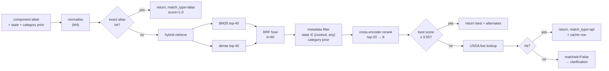

# 03 — Nutrition Knowledge Base and RAG Design

> The report claim we need to defend: *"every calorie displayed is traceable to a specific row in a published composition table."* This document is the mechanism behind that claim.

---

## 1. Corpus composition

| Source | Content | Rows (approx.) | Role | Licence / access |
|---|---|---|---|---|
| **IFCT 2017** — *Indian Food Composition Tables*, NIN Hyderabad | 528 foods, ~150 nutrients, per 100 g edible portion, raw and cooked states | ~528 foods | **Primary** for Indian dishes | Published table; values are facts, but cite the source. No bulk API — transcribed to CSV by the team (see §2.4) |
| **USDA FoodData Central** — Foundation + SR Legacy + FNDDS | ~400 k items incl. branded | ~8 k curated non-branded subset | **Fallback / coverage** | Public domain. Free API key, default limit 1 000 req/hour/IP |
| **Recipe decomposition table** (team-authored) | Composite Indian dishes → ingredient fractions | 30–40 dishes | Handles dishes that cannot be visually separated | Derived from standard recipes + IFCT ingredient values |
| **Portion model table** (team-measured) | Density ρ and heap factor k per food class | ~15 classes | Portion estimation constants | Team's own weighing session |
| **Alias table** (team-authored) | English ↔ Telugu/Hindi ↔ common spellings | ~800 aliases | Matching precision | Team-authored |

**Why not a single source?** IFCT covers Indian foods well but not everything (no "paneer tikka" row, no packaged items). USDA covers the rest but has weak Indian coverage and some composite FNDDS entries whose values reflect US formulations. The hybrid is a deliberate, defensible design choice, not a fallback.

**What we deliberately do not do:** scrape nutrition blogs, use LLM-generated nutrition values, or average conflicting sources silently. One record wins, and the record's source is displayed.

---

## 2. Ingestion pipeline

```
raw/ifct2017.csv          ─┐
raw/usda_subset.json      ─┼→  normalize.py  →  foods.parquet  →  load_sqlite.py  →  app.db
raw/dish_recipes.csv      ─┤                                  └→  build_index.py  →  chroma/
raw/aliases.csv           ─┘
```

### 2.1 Normalisation contract

Every source row becomes a `FoodRecord`:

```python
@dataclass
class FoodRecord:
    source: str                  # IFCT2017 | USDA_FDC
    source_ref: str              # IFCT food code | fdcId
    canonical_name: str          # lower_snake: "rice_cooked"
    display_name: str            # "Rice, cooked (white, milled)"
    category: str                # cereal | pulse | vegetable | dairy | meat | oil | ...
    physical_state: str          # raw | cooked | fried | gravy | liquid
    edible_portion_pct: float    # USDA "refuse" → 100 - refuse
    nutrients: dict[str, float]  # per 100 g, canonical codes only
    household_measures: list[HouseholdMeasure]
    aliases: list[str]
```

Quantity units are the biggest silent bug source. Rules:

- IFCT reports energy in **kJ** — convert to kcal with `kcal = kJ / 4.184`, never mix.
- IFCT reports some micronutrients in µg — store canonical units and label them.
- USDA `protein` is in g, `Energy` may appear twice (kcal and kJ) — select by unit field, not by order.
- `edible_portion_pct` must be applied at *portion* time, not ingestion time: a banana with peel has 64 % edible portion.

### 2.2 Canonical nutrient set

| Code | Unit | Notes |
|---|---|---|
| `energy_kcal` | kcal | converted from kJ where needed |
| `protein_g` | g | |
| `carb_g` | g | by difference if unavailable |
| `fat_g` | g | total lipid |
| `fibre_g` | g | total dietary fibre |
| `sugar_g` | g | optional |
| `sodium_mg` | mg | optional |

Absence is `NULL`, never `0`. This distinction is what lets the UI say "fibre: not reported" instead of lying.

### 2.3 Deduplication

IFCT and USDA overlap on staples (rice, milk, egg). Keep **both**, but:

1. Mark `is_preferred=1` on the IFCT row for Indian-context queries.
2. Retrieval uses `source_priority` as a tie-breaker within 0.03 score: `IFCT2017 > USDA_FDC`.
3. Never merge nutrient values across sources — a merged row has no provenance.

### 2.4 IFCT transcription protocol (do this properly, it is a viva question)

1. Two members transcribe independently into separate CSVs.
2. Diff with `pandas.testing.assert_frame_equal`; every mismatch is resolved against the printed table by a third member.
3. Store the page number in `food_nutrient.note` for each transcribed row.
4. Start with the **~120 rows that cover the demo dishes**, not all 528. Coverage first, breadth later.

---

## 3. Two retrieval targets (the key design idea)

Most food-RAG projects index only "food → per-100 g". That fails on a plate of biryani, where the *visible* object is a composite dish but the *nutrients* belong to its ingredients. We therefore run **two collections**.

### Collection A — `foods` (ingredient-level)

One document per food record.

```
name: rice_cooked
display: Rice, cooked (white, milled)
category: cereal
state: cooked
aliases: rice, white rice, steamed rice, annam, chawal, cooked rice
per100g: energy_kcal 130; protein_g 2.7; carb_g 28.2; fat_g 0.3; fibre_g 0.4
measures: 1 katori (150 ml) = 125 g; 1 cup (240 ml) = 200 g
source: IFCT2017 13-026
```

**Use:** default path for every component the VLM identifies as a distinct food.

### Collection B — `dishes` (composite-level)

One document per composite dish, carrying its *recipe fractions* and the ingredient food ids.

```
dish: vegetable_biryani
category: composite
ingredients: rice_cooked 0.55; mixed_vegetables 0.20; oil 0.08; curd 0.07; spices 0.05; onion 0.05
per100g_derived: energy_kcal 168; protein_g 3.6; ...
source: team recipe table v1 (derived from IFCT ingredient rows)
```

`per100g_derived` is **computed at build time** by the same M7 arithmetic used at inference — one code path, so a derived value and a live calculation can never disagree.

**Use:** only when `is_composite=True` *and* the VLM reports no separable components, or when the user selects "this is one dish" in the clarification step. Never used to override a successful decomposition.

### Why two indices matter for the report

This is the concrete answer to *"what is novel in your RAG?"*:

> Conventional ingredient retrieval cannot answer for a composite plate; single-record retrieval for composite dishes loses ingredient-level transparency. Dual-index retrieval with a computed-recipe fallback preserves provenance at both granularities.

---

## 4. Embedding and index build

| Setting | Value | Reason |
|---|---|---|
| Embedding model | `BAAI/bge-small-en-v1.5` | 384-d, CPU-fast (~15 ms/doc), strong on short entity strings; `bge` wants the `"Represent this sentence for searching relevant passages: "` prefix on queries only |
| Alt for regional names | `intfloat/multilingual-e5-small` | Use if Hindi/Telugu query strings appear in the UI |
| Vector store | ChromaDB persistent client, cosine space | file-based, metadata filters |
| Collection A | `foods_v1` (HNSW, `M=16`, `ef_construction=100`) | ~1 k docs, search is instant |
| Collection B | `dishes_v1` | ~50 docs |
| BM25 | `bm25s` over the same rendered text, `k1=1.5`, `b=0.75` | exact-name recall |
| Reranker | `cross-encoder/ms-marco-MiniLM-L-6-v2` | CPU-runnable; used on top-20 |

**Versioning:** index directory is `data/chroma/{collection}_{kb_version}`; `kb_version` (e.g. `2026.11.1`) is stored on every `analyses` row. Changing the corpus never mutates an old analysis.

**Rebuild command:** `python -m app.rag.build_index --kb data/kb/2026.11.1 --out data/chroma` — idempotent, prints doc counts per collection.

---

## 5. Query pipeline



**RRF formula** (rank-based, no score-scale assumptions):

```
rrf(d) = Σ_{r ∈ {bm25, dense}} 1 / (60 + rank_r(d))
```

Normalise to `[0,1]` by dividing by the theoretical best (2/61) for display; keep the raw value internally.

**Metadata filters are applied before ANN search**, not after — Chroma `where={"state": {"$in": ["cooked","any"]}}`. This is why a query for "rice" on a cooked plate does not return raw rice at 345 kcal/100 g instead of 130.

**Category prior:** the router sets a weak prior from the dish context (a South Indian thali biases toward `cereal`, `pulse`, `vegetable`). Implemented as a `+0.02` boost, never as a hard filter — priors must not make an unseen food unreachable.

---

## 6. Thresholds and decision rules

| Situation | Rule | Rationale |
|---|---|---|
| Alias exact match | accept, `score=1.0` | highest precision path |
| Rerank score ≥ 0.75 | accept, high match confidence | strong semantic agreement |
| 0.55 ≤ score < 0.75 | accept but mark `match_confidence=medium`, ask a confirmation question if tier ≥ T1 | zone where wrong-but-plausible lives |
| score < 0.55 | do not accept; try live USDA; else `matched=False` | better unknown than wrong |
| Top-2 scores within 0.03 | ambiguous → include both as clarification options | "Is this paneer or tofu?" |
| `state` mismatch (query cooked, only raw available) | accept raw + apply yield factor; flag `state_converted` | a raw-only record is still better than nothing, but must be labelled |

**Yield factors** (raw → cooked mass change, applied to mass, not to nutrients-per-100 g):

| Food | Factor | Note |
|---|---|---|
| Rice | ÷ 2.8 | 100 g raw → 280 g cooked |
| Dal | ÷ 2.3 | |
| Pasta | ÷ 2.4 | |
| Chicken (boiled) | × 0.75 | water loss |
| Chapati (from atta) | × 1.35 | water + oil gain |

Implementation note: when converting, prefer to scale the **mass** and keep per-100 g nutrients of the matched record — i.e. `grams_effective = grams × factor`, then re-flag. This is an approximation and is labelled as such in `limitations`.

---

## 7. USDA live fallback

Used when the local index misses. Constraints that make this safe:

- Only `Foundation`, `SR Legacy`, `Survey (FNDDS)` data types; **branded foods excluded** by default (wildly inconsistent values, and a student project should not present a specific brand as ground truth).
- `POST /v1/foods/search` with `{query, dataType, pageSize: 5}`; select the best by a small reranker, not by position.
- **Cache every response** in `usda_cache(query_hash, query, fdc_id, payload_json, fetched_at)` with a 90-day TTL. Re-running the demo never depends on the network.
- Timeout 8 s, 2 retries, `429` → back off and degrade to local-only with `stale_kb` flag.
- Units re-normalised to the canonical set on the way in; a USDA record that cannot be normalised is dropped, not guessed.

---

## 8. Retrieval evaluation (runs before the app is built)

Small but real: a gold set of **200 Chinese-English query strings** sampled from actual VLM labels on the team's photos, each with the correct food id.

| Metric | Target |
|---|---|
| Recall@1 | ≥ 0.65 |
| Recall@5 | ≥ 0.88 |
| MRR | ≥ 0.75 |
| Exact-name subset Recall@1 (n=80) | ≥ 0.95 |
| Ablation: dense-only Recall@5 | report (expected 0.70–0.80) |
| Ablation: no state filter, cooked-rice query | report top-1 kcal (expected 345 vs 130) |

That last ablation is a perfect table for the report — it demonstrates *why* the state filter exists with a concrete number.

---

## 9. Files and build order

```
data/kb/2026.11.1/
├── raw/
│   ├── ifct2017_transcribed.csv
│   ├── usda_subset.json
│   ├── dish_recipes.csv
│   ├── aliases.csv
│   └── portion_model.csv
├── processed/
│   ├── foods.parquet
│   └── dishes.parquet
└── manifest.json          # counts, hashes, build timestamp, kb_version

data/chroma/
├── foods_v1/              # ~1 000 docs
└── dishes_v1/             # ~50 docs
```

Build order (each step fails loudly, never silently):

1. `python -m app.rag.validate_kb` — schema + unit checks (no per-100 g value > 900 kcal except pure oils/fats; no negative values; every food has a source ref).
2. `python -m app.rag.build_index` — embeddings + Chroma + BM25 pickle.
3. `python -m app.rag.eval_retrieval --gold data/kb/gold_queries.csv` — prints the table in §8.
