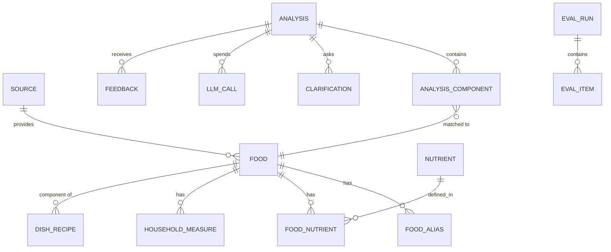

# 04 — Data Model

Two stores, one rule: **structured facts in SQLite, similarity in Chroma, blobs on disk.** Nothing important lives only inside a vector store.

- Relational store: SQLite (WAL mode) at `data/app.db`.
- Vector store: Chroma persistent at `data/chroma/`.
- Artifacts: `data/artifacts/{analysis_id}/`.

All DDL below is **Postgres-compatible** except where marked `-- sqlite`. Migration to Postgres is a connection-string + autoincrement change.

---

## 1. Entity relationships



---

## 2. Knowledge-base tables

```sql
PRAGMA journal_mode = WAL;
PRAGMA foreign_keys = ON;

-- ─────────────────────────────────────────────── provenance
CREATE TABLE source (
    id            INTEGER PRIMARY KEY,
    code          TEXT NOT NULL UNIQUE,        -- 'IFCT2017' | 'USDA_FDC' | 'CUSTOM'
    name          TEXT NOT NULL,
    version       TEXT,                        -- '2017' | 'Foundation 2026-04'
    url           TEXT,
    license       TEXT,
    priority      INTEGER NOT NULL DEFAULT 100, -- lower wins ties
    retrieved_at  TEXT
);

-- ─────────────────────────────────────────────── canonical food
CREATE TABLE food (
    id                INTEGER PRIMARY KEY,
    source_id         INTEGER NOT NULL REFERENCES source(id),
    source_ref        TEXT NOT NULL,           -- IFCT code or fdcId
    canonical_name    TEXT NOT NULL,           -- 'rice_cooked'
    display_name      TEXT NOT NULL,
    category          TEXT NOT NULL,           -- cereal|pulse|vegetable|dairy|meat|oil|fruit|composite|other
    physical_state    TEXT NOT NULL,           -- raw|cooked|fried|gravy|liquid|any
    is_composite      INTEGER NOT NULL DEFAULT 0,
    is_preferred      INTEGER NOT NULL DEFAULT 0,
    edible_portion_pct REAL NOT NULL DEFAULT 100,
    default_portion_g REAL,
    density_g_ml      REAL,
    notes             TEXT,
    UNIQUE (source_id, source_ref)
);
CREATE INDEX idx_food_canonical ON food(canonical_name);
CREATE INDEX idx_food_category  ON food(category, physical_state);

CREATE TABLE food_alias (
    id        INTEGER PRIMARY KEY,
    food_id   INTEGER NOT NULL REFERENCES food(id) ON DELETE CASCADE,
    alias     TEXT NOT NULL,
    lang      TEXT NOT NULL DEFAULT 'en',      -- en|te|hi|translit
    weight    REAL NOT NULL DEFAULT 1.0,       -- 1.0 exact, <1 dispreferred
    UNIQUE (food_id, alias)
);
CREATE INDEX idx_alias_lookup ON food_alias(alias);

-- ─────────────────────────────────────────────── nutrients
CREATE TABLE nutrient (
    id    INTEGER PRIMARY KEY,
    code  TEXT NOT NULL UNIQUE,   -- energy_kcal | protein_g | ...
    name  TEXT NOT NULL,
    unit  TEXT NOT NULL,
    kind  TEXT NOT NULL           -- macro|micro|other
);

CREATE TABLE food_nutrient (
    food_id       INTEGER NOT NULL REFERENCES food(id) ON DELETE CASCADE,
    nutrient_id   INTEGER NOT NULL REFERENCES nutrient(id),
    amount_per_100g REAL,                       -- NULL = not reported (never 0)
    min_value     REAL,
    max_value     REAL,
    data_points   INTEGER,
    note          TEXT,                         -- IFCT page number etc.
    PRIMARY KEY (food_id, nutrient_id)
);

CREATE TABLE household_measure (
    id        INTEGER PRIMARY KEY,
    food_id   INTEGER NOT NULL REFERENCES food(id) ON DELETE CASCADE,
    label     TEXT NOT NULL,      -- '1 katori'
    volume_ml REAL,
    weight_g  REAL NOT NULL
);

-- ─────────────────────────────────────────────── composite dishes
CREATE TABLE dish_recipe (
    id             INTEGER PRIMARY KEY,
    dish_food_id   INTEGER NOT NULL REFERENCES food(id) ON DELETE CASCADE,
    component_food_id INTEGER NOT NULL REFERENCES food(id),
    fraction       REAL NOT NULL CHECK (fraction > 0 AND fraction <= 1),
    fraction_min   REAL,
    fraction_max   REAL,
    basis          TEXT,          -- 'team recipe v1'
    UNIQUE (dish_food_id, component_food_id)
);

-- ─────────────────────────────────────────────── portion constants
CREATE TABLE portion_model (
    id           INTEGER PRIMARY KEY,
    food_class   TEXT NOT NULL UNIQUE,   -- cereal_cooked | gravy | bread ...
    density_g_ml REAL NOT NULL,
    heap_k       REAL NOT NULL,          -- h = k * sqrt(A_cm2)
    shape_factor REAL NOT NULL DEFAULT 1.0,
    fill_factor  REAL NOT NULL DEFAULT 0.70,
    mass_min_g   REAL,
    mass_max_g   REAL,
    source_note  TEXT,
    measured_at  TEXT
);
```

---

## 3. Runtime tables

```sql
CREATE TABLE analysis (
    id                TEXT PRIMARY KEY,          -- uuid4 hex
    created_at        TEXT NOT NULL,
    updated_at        TEXT NOT NULL,
    status            TEXT NOT NULL,             -- received|running|needs_clarification|complete|partial|failed|rejected
    tier              TEXT,                      -- T0|T1|T2
    image_path        TEXT,
    image_phash       TEXT,
    image_quality     REAL,
    context_text      TEXT,
    provider          TEXT,
    model             TEXT,
    prompt_version    TEXT,
    kb_version        TEXT,
    compute_version   TEXT,
    total_kcal_p50    REAL,
    total_kcal_p10    REAL,
    total_kcal_p90    REAL,
    meal_confidence   REAL,
    latency_ms        INTEGER,
    cost_usd          REAL,
    error_json        TEXT
);
CREATE INDEX idx_analysis_created ON analysis(created_at DESC);
CREATE INDEX idx_analysis_status  ON analysis(status);

CREATE TABLE analysis_component (
    id                INTEGER PRIMARY KEY,
    analysis_id       TEXT NOT NULL REFERENCES analysis(id) ON DELETE CASCADE,
    ord               INTEGER NOT NULL,
    label_raw         TEXT NOT NULL,
    label_display     TEXT NOT NULL,
    bbox_norm         TEXT NOT NULL,             -- JSON [x0,y0,x1,y1]
    crop_path         TEXT,
    food_id           INTEGER REFERENCES food(id),
    match_type        TEXT,                      -- alias|fuzzy|semantic|api|composite|none
    match_score       REAL,
    matched_state     TEXT,
    mass_g            REAL,
    mass_ci_low       REAL,
    mass_ci_high      REAL,
    portion_method    TEXT,
    portion_features  TEXT,                      -- JSON, for the report
    kcal              REAL,
    protein_g         REAL,
    carb_g            REAL,
    fat_g             REAL,
    fibre_g           REAL,
    nutrients_json    TEXT,                      -- full canonical dict
    confidence        REAL,
    confidence_raw    REAL,
    flags_json        TEXT,                      -- ["state_converted","composite_recipe"]
    UNIQUE (analysis_id, ord)
);
CREATE INDEX idx_component_analysis ON analysis_component(analysis_id);

CREATE TABLE clarification (
    id            INTEGER PRIMARY KEY,
    analysis_id   TEXT NOT NULL REFERENCES analysis(id) ON DELETE CASCADE,
    component_ord INTEGER,
    kind          TEXT NOT NULL,    -- confirm_identity|choose_between|portion_scale|composite_confirm|free_text
    question      TEXT NOT NULL,
    options_json  TEXT,
    answer        TEXT,
    answered_at   TEXT,
    info_gain     REAL              -- predicted error reduction, for the report
);
CREATE INDEX idx_clarification_analysis ON clarification(analysis_id);

CREATE TABLE feedback (
    id            INTEGER PRIMARY KEY,
    analysis_id   TEXT NOT NULL REFERENCES analysis(id) ON DELETE CASCADE,
    component_ord INTEGER,
    field         TEXT NOT NULL,   -- food_id|mass_g|label|delete|add
    predicted     TEXT,
    corrected     TEXT,
    created_at    TEXT NOT NULL
);

CREATE TABLE llm_call (
    id          INTEGER PRIMARY KEY,
    analysis_id TEXT REFERENCES analysis(id) ON DELETE CASCADE,
    agent       TEXT NOT NULL,
    provider    TEXT NOT NULL,
    model       TEXT NOT NULL,
    in_tokens   INTEGER,
    out_tokens  INTEGER,
    latency_ms  INTEGER,
    cost_usd    REAL,
    ok          INTEGER NOT NULL DEFAULT 1,
    error       TEXT,
    created_at  TEXT NOT NULL
);
CREATE INDEX idx_llm_call_analysis ON llm_call(analysis_id);

CREATE TABLE usda_cache (
    query_hash  TEXT PRIMARY KEY,
    query       TEXT NOT NULL,
    fdc_id      TEXT,
    payload_json TEXT NOT NULL,
    fetched_at  TEXT NOT NULL
);

CREATE TABLE calibration_model (
    id          INTEGER PRIMARY KEY,
    name        TEXT NOT NULL,          -- 'isotonic_v1'
    kind        TEXT NOT NULL,          -- isotonic|platt
    params_json TEXT NOT NULL,
    n_samples   INTEGER,
    ece         REAL,
    trained_at  TEXT NOT NULL,
    is_active   INTEGER NOT NULL DEFAULT 0
);
```

---

## 4. Evaluation tables

```sql
CREATE TABLE eval_dataset (
    id         INTEGER PRIMARY KEY,
    name       TEXT NOT NULL UNIQUE,   -- 'gold_v1'
    n_images   INTEGER,
    notes      TEXT,
    created_at TEXT NOT NULL
);

CREATE TABLE eval_item (
    id           INTEGER PRIMARY KEY,
    dataset_id   INTEGER NOT NULL REFERENCES eval_dataset(id) ON DELETE CASCADE,
    image_path   TEXT NOT NULL,
    split        TEXT NOT NULL,        -- train|dev|test
    ground_truth TEXT NOT NULL         -- JSON: components[{name, mass_g}], totals
);

CREATE TABLE eval_run (
    id          INTEGER PRIMARY KEY,
    dataset_id  INTEGER NOT NULL REFERENCES eval_dataset(id),
    config_name TEXT NOT NULL,         -- 'full' | 'no_rag' | 'no_decomposition' | ...
    git_sha     TEXT,
    started_at  TEXT NOT NULL,
    finished_at TEXT,
    metrics_json TEXT
);

CREATE TABLE eval_result (
    id          INTEGER PRIMARY KEY,
    run_id      INTEGER NOT NULL REFERENCES eval_run(id) ON DELETE CASCADE,
    item_id     INTEGER NOT NULL REFERENCES eval_item(id),
    prediction  TEXT NOT NULL,
    metrics_json TEXT
);
```

---

## 5. Views used by the UI

```sql
-- Component table with provenance resolved in one query
CREATE VIEW v_component_report AS
SELECT c.analysis_id, c.ord, c.label_display, c.mass_g,
       c.mass_ci_low, c.mass_ci_high, c.kcal, c.protein_g, c.carb_g, c.fat_g,
       c.confidence, c.flags_json,
       f.display_name AS kb_name,
       s.code         AS source_code,
       f.source_ref   AS source_ref
FROM analysis_component c
LEFT JOIN food   f ON f.id = c.food_id
LEFT JOIN source s ON s.id = f.source_id;

-- Macro energy split
CREATE VIEW v_meal_macros AS
SELECT analysis_id,
       SUM(protein_g*4) AS kcal_protein,
       SUM(carb_g*4)    AS kcal_carb,
       SUM(fat_g*9)     AS kcal_fat
FROM analysis_component
GROUP BY analysis_id;
```

---

## 6. Chroma collections

| Collection | Doc id | Metadata (filterable) | Document text |
|---|---|---|---|
| `foods_v1` | `food_{id}` | `food_id, category, physical_state, source, is_composite` | rendered food card (§03 §3) |
| `dishes_v1` | `dish_{id}` | `food_id, category, source` | rendered dish card with `per100g_derived` |

Metadata values must be **scalars only** (Chroma limitation): store flags as `0/1` ints, never bools or lists.

`kb_version` is in the collection name and in `analysis.kb_version`, tying every stored report to the exact index that produced it.

---

## 7. Artifact layout

```
data/artifacts/{analysis_id}/
├── input.jpg                 # normalised 1024px
├── crops/
│   ├── 00_rice.jpg
│   └── 01_dal.jpg
├── raw/
│   ├── perception_1.json     # full provider response, unparsed
│   ├── critic_1.json
│   └── consistency_2.json
└── report.json               # frozen AnalysisResponse
```

`report.json` is the replay artefact: the evaluation harness and the UI can both load it without touching the model, which makes demos deterministic and debugging trivial.

---

## 8. Retention and privacy

| Data | Retention | Action |
|---|---|---|
| `input.jpg`, crops | until user deletes; default 30 days | purge job on startup |
| `raw/*.json` | 30 days | purge job |
| `analysis`, `analysis_component` | indefinite (metrics only) | anonymise on delete |
| `feedback` | indefinite | used for evaluation, never for ad-hoc prompt tuning without versioning |
| `llm_call` | indefinite | cost analysis |

`DELETE /v1/analyses/{id}` removes artifacts and cascades DB rows. `POST /v1/privacy/purge` wipes all images older than the retention window.

---

## 9. Seed data required before first run

1. `source` — 3 rows.
2. `nutrient` — 7 canonical rows.
3. `portion_model` — 15 rows (densities).
4. `food` + `food_alias` — **≥ 25 foods** covering the demo meals (rice, chapati, dal, sambar, rasam, curd, paneer curry, mixed veg, biryani, idli, dosa, upma, poha, egg, chicken curry, salad, pickle, papad, ghee, oil, sugar, tea, banana, apple, milk).
5. `dish_recipe` — ≥ 6 composites.

Everything else is optional at demo time. **Coverage of the demo dish set is what matters, not corpus size** — say this explicitly in the report so nobody asks "why only 1 000 foods".
