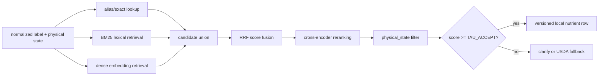

# Final Methodology

## Adaptive Food Recognition and Nutritional Estimation Using Multimodal AI

**Document purpose.** This is the consolidated methodology for the academic report and first presentation. It reconciles `ARCHITECTURE.md` with `docs/01`–`docs/09`, and separates the project specification from implementation status and future work.

**Status convention**

| Label | Meaning |
|---|---|
| **Specified** | Required by the project documents and treated as the proposed system method. |
| **Reference/design** | Named in the documents as a possible provider, component, or optimization, but not a claim of completed implementation. |
| **Future evaluation** | An experiment, dataset, or calibration step planned by `docs/08`, not evidence that it has already been run. |

The workspace is documentation-only at this stage: no application, benchmark run, or production result should be described as completed unless separately evidenced.

## 1. Methodological objective and non-negotiable invariants

The system estimates nutrition by decomposing a photographed meal into components and computing:

\[
N_{meal}=\sum_{i=1}^{K}m_i\,n_i/100
\]

where \(m_i\) is the estimated mass in grams and \(n_i\) is a nutrient value per 100 g retrieved from the knowledge base. The visual model identifies and describes food; it does **not** produce calories, grams, macronutrients, or other nutrient values.

The following are methodological constraints, not implementation suggestions:

1. Nutrient arithmetic is deterministic Python; no language model is in the calculation path.
2. `NULL` means “not reported”, never zero. Missing nutrient fields remain missing during aggregation.
3. Retrieval is filtered by `physical_state`; this prevents, for example, cooked rice being matched to a raw-rice record.
4. The UI renders fields from the validated `AnalysisResponse`; it does not calculate nutrition.
5. A match below `TAU_ACCEPT = 0.55` is not accepted. It is routed to clarification or reported as unmatched.
6. Every report records `provider`, `model`, `prompt_version`, `kb_version`, and `compute_version`.
7. `MOCK_MODE=1` is the default offline path. Mock responses are deterministic and keyed by the SHA-256 of image bytes.
8. Provider adapters return validated Pydantic objects or raise; partial or unvalidated dictionaries are not accepted.

## 2. Complete workflow

```mermaid
flowchart TD
    A[Meal image + optional context] --> B[M1 intake and quality gate]
    B -->|decode/quality failure| X[Rejected problem+json response]
    B --> C[M2 optional adaptive route]
    C --> D[M3 multimodal component perception]
    D -->|no usable components| X
    D --> E[M4 label and regional-name normalization]
    E --> F[M6 hybrid retrieval]
    F --> G[M5 scale and portion estimation]
    G --> H[M7 deterministic nutrient computation]
    H --> I[M8 critic/verifier]
    I --> J[M9 feature fusion and calibration]
    J -->|all accepted| K[M10 report + M11 provenance]
    J -->|uncertain component(s)| L[Ranked clarification questions]
    L -->|answered, max MAX_ROUNDS| G
    L -->|skipped/limit reached| K
    K --> N[AnalysisResponse]
```

The API boundary is `POST /v1/analyses` with a multipart image and optional context. A clarification answer is submitted to `POST /v1/analyses/{id}/clarify`; the graph resumes at portion estimation and recomputes the affected downstream tail. `GET /v1/analyses/{id}` replays the persisted report.

## 3. M1: image preprocessing and quality assessment

**Specified method**

1. Decode with Pillow and correct phone orientation using EXIF transpose.
2. Convert to RGB and remove problematic alpha/ICC variants.
3. Resize the longest side to 1024 px using LANCZOS.
4. Compute a quality score from blur, luminance, and resolution:

```text
laplacian_var = variance(Laplacian(gray))
q_blur = clip((laplacian_var - 40) / 260, 0, 1)
q_luma = 1 - abs(mean_luma - 128) / 128
q_res  = clip(min(width, height) / 720, 0, 1)
quality = 0.5*q_blur + 0.3*q_luma + 0.2*q_res
```

The result stores the normalized image path, dimensions, quality flags, perceptual hash, and rejection reason. An undecodable image or `min(width,height) < 256` is rejected. Blur, darkness, overexposure, or low resolution otherwise lower confidence rather than silently discarding the sample. Blur below 0.25 forces at least the ambiguous route and adds a retake hint.

These thresholds are project design parameters, not universal image-quality laws. They must be validated on `gold_v1`; the report should not claim that 1024 px or Laplacian variance is optimal without an ablation.

## 4. M3: multimodal perception and structured output

The perception provider receives the normalized image and optional user context (for example, “home lunch, medium steel plate”) and returns a schema-validated `Decomposition`:

| Field | Role |
|---|---|
| `label`, `local_name` | Free-text/cultural description for matching |
| `bbox_norm` | Normalized component region |
| `relative_size` | Tiny/small/medium/large/xl visual prior |
| `physical_state` | Raw, cooked, fried, gravy, liquid, or mixed |
| `is_container` | Enables plate/bowl/reference-object handling |
| `occlusion` | Estimated hidden fraction |
| `notes` | Non-numeric visual observations |

The schema deliberately has no mass, calorie, energy, macro, or nutrient field. Post-validation clamps boxes to `[0,1]`, removes zero-area boxes, merges near-duplicate same-label boxes, removes containers from the nutrition list while retaining them as possible scale anchors, and flags disagreement between reported and parsed component counts.

For T1/T2, padded component crops are sent to a verification call. The verifier checks identity and visible cooking method; a disagreement changes the label source to `verified` and is recorded as evidence, not as a nutrient estimate. The model may state uncertainty or observations, but it never writes the final numeric nutrition.

## 5. M4: food matching and regional-name normalization

Matching is a controlled bridge between visual language and database identifiers:

1. Lowercase, remove quantities/articles/parentheticals, collapse whitespace, and singularize.
2. Transliterate or map known Hindi/Telugu and other regional variants.
3. Check exact aliases in `food_alias` first.
4. Use fuzzy matching against canonical names and aliases (the design specifies RapidFuzz `WRatio >= 88` as a candidate rule).
5. Pass the normalized label, local name, cooking state, cuisine/context, and component notes to retrieval.

Normalization must preserve distinctions that affect composition: raw versus cooked, fried versus boiled, gravy versus dry preparation, and ingredient versus composite dish. It should not collapse culturally different foods merely because their English spellings are similar. The user-facing report should retain the observed/local label alongside the canonical database label.

## 6. M6: hybrid RAG and nutrient-source policy

The knowledge base has two derived indexes:

* **Ingredient index:** IFCT 2017 records plus a versioned USDA FoodData Central snapshot.
* **Composite/dish index:** recipe-level records whose ingredient fractions resolve back to ingredient records and preserve provenance.

The query path is:



The local index is the reproducible primary source. A live USDA FoodData Central lookup is a cache miss/fallback, not permission to invent a value. USDA’s official API provides food search and food-details endpoints and requires an API key; its data are public domain under CC0, with attribution requested ([USDA API guide](https://fdc.nal.usda.gov/api-guide/)). If the network is unavailable, the local index remains usable and a `stale_kb` flag can be reported.

Every candidate is filtered on `physical_state` before acceptance. A high lexical or dense score cannot override a state mismatch. Composite dishes are either represented by a provenance-preserving recipe decomposition or marked unmatched; silently treating biryani as plain rice is an evaluation error (`E-COMPOSITE`).

**Citation boundary.** RAG supports grounded lookup and provenance; it does not make visual recognition correct. Lewis et al. describe RAG as combining parametric and non-parametric memory and emphasize provenance/updateability as motivations ([NeurIPS 2020 / arXiv:2005.11401](https://arxiv.org/abs/2005.11401)).

## 7. M5: portion, volume, mass, and intervals

The estimator uses the strongest available scale evidence:

1. A known reference object (spoon/fork or user-provided object) is preferred.
2. Plate/bowl geometry is used when the object type and diameter are known or inferred with sufficient confidence.
3. Without a physical anchor, relative-size and household-serving priors provide a wider interval and lower confidence.

For a component:

\[
A_i = A_{image,i}\left(\frac{s_{real}}{s_{image}}\right)^2,\quad
V_i \approx A_i h_i f_{shape},\quad
m_i = \rho_i V_i
\]

where \(s\) is the scale anchor, \(h_i\) is an estimated depth/thickness, \(f_{shape}\) is a shape/heap factor, and \(\rho_i\) is a state-specific density. The calibration session in `gold_v1` is intended to estimate density and heap factors; it is not a substitute for independent test ground truth.

The output is a median or point estimate plus a lower/upper interval, not false precision. Uncertainty widens with occlusion, absent anchors, ambiguous depth, and uncertain state. The specified total propagation samples mass errors as log-normal distributions with a fixed seed and reports P10/P50/P90. Nutrient values may also have source/recipe uncertainty, which should be represented separately from mass uncertainty rather than hidden inside a single confidence number.

This design is deliberately less ambitious than a depth-enabled end-to-end predictor. Nutrition5k demonstrates the value of RGB-D, component weights, and nutrient annotations, but its overhead-camera cafeteria distribution is not equivalent to Indian home meals ([Thames et al., CVPR 2021](https://arxiv.org/abs/2103.03375)).

## 8. M7: deterministic computation and provenance

For each accepted match and mass interval, the calculator:

1. Converts IFCT energy from kJ to kcal by dividing by 4.184.
2. Multiplies each non-null per-100 g nutrient by \(m_i/100\).
3. Aggregates components and computes interval totals from the sampled masses.
4. Preserves `NULL` as not reported; it does not coerce missing values to zero.
5. Stores food ID, source, state, nutrient row version, mass estimate/interval, conversion version, and computation version.

The calculator is pure Python and must be unit-tested independently of FastAPI, Streamlit, LangGraph, a model provider, or a network. The report therefore distinguishes “not reported” from zero and exposes component-level provenance so a reviewer can trace a number back to a source row and mass estimate.

## 9. M8: critic/verifier and multimodal integration

The critic receives the image, component evidence, retrieval table, mass estimates, and computed nutrient table. It returns structured flags/verdicts, never replacement nutrition values. Checks include:

* visual/component consistency and missed or duplicated items;
* mass balance against plate/anchor geometry;
* density/state plausibility;
* macro/energy sanity and unit consistency;
* agreement between initial perception and crop verification;
* optional self-consistency disagreement for ambiguous routes.

The critic can veto acceptance or lower confidence. It cannot “correct” arithmetic by guessing. If it proposes a different food, that proposal must re-enter normal matching/retrieval and pass the same state and threshold rules.

## 10. M9: confidence, calibration, uncertainty, and clarification

The specified raw component score combines:

\[
s=.28s_{ident}+.20s_{retr}+.18s_{port}+.14s_{crit}
 .08s_{img}+.07s_{state}+.05s_{cover}
\]

Hard caps are applied before calibration: unmatched ≤ 0.25, critic veto ≤ 0.40, and severe blur ≤ 0.55. A fitted isotonic calibrator maps the raw score to an empirical probability-like confidence. Isotonic regression is monotonic rather than a claim that the raw score is already probabilistic ([scikit-learn documentation](https://scikit-learn.org/stable/modules/isotonic.html)).

Meal confidence is coverage-adjusted and mass-weighted:

\[
c_{meal}=coverage^{0.5}\sum_i w_i c_i
\]

Low confidence is a selective prediction decision, not a model failure to conceal. The system ranks questions by expected information gain per user effort, for example:

* “Is this rice cooked or uncooked?”
* “Is the bowl/plate approximately 20 cm in diameter?”
* “Is the hidden item chicken, paneer, or another ingredient?”
* “Was oil/ghee added separately?”

It asks only the highest-value questions, permits skipping, and enforces `MAX_ROUNDS = 2`. An answered clarification re-runs the affected portion-to-report tail; a skipped question produces a flagged low-confidence report. This follows the reject-option logic of selective classification, where coverage is traded for controlled risk ([Geifman & El-Yaniv, 2017](https://arxiv.org/abs/1705.08500)).

Confidence calibration and interval coverage must be evaluated separately. A calibrated identity score does not prove that a P90 mass interval contains the true mass.

## 11. Adaptive routing: main method versus optimization

The **main scientific workflow** is always component decomposition → state-aware matching/retrieval → anchored/priored portion estimation → deterministic computation → verification → calibrated report/clarification. It remains valid without adaptive routing.

The documented T0/T1/T2 router is an **internal compute optimization**:

| Tier | Trigger and extra work | Intended use |
|---|---|---|
| T0 | Sharp, simple, one dominant component; no crop verification/consistency sampling | Low-cost path |
| T1 | Mixed plate, 2–8 components; crop verification and critic | Default mixed meal |
| T2 | Blur/occlusion/unknown cuisine, >8 components, or critic veto; detector and self-consistency options | Ambiguous cases |

The documented thresholds are `q >= .75` for a simple route, `q < .45` or more than eight components for T2, otherwise T1. The route must not remove safety gates, state filtering, deterministic arithmetic, provenance, or clarification. The claim that adaptive routing reduces cost/latency without accuracy loss is **future evaluation**, not an assumption.

## 12. Alternatives considered

| Alternative | Decision and reason |
|---|---|
| Whole-dish VLM asking directly for calories | Rejected: collapses mixed meals and violates the no-model-nutrition invariant. |
| VLM-generated grams/nutrients with a post-hoc parser | Rejected: parsing does not make hallucinated values authoritative. |
| Single dense retrieval index | Rejected: weak on aliases and regional spellings; hybrid lexical+dense retrieval is more robust. |
| No state filter | Rejected: raw/cooked substitutions create large systematic errors. |
| Fixed household priors only | Rejected as the primary estimator: no scale anchor and poor transfer across serving sizes. Retained as fallback. |
| End-to-end RGB-to-calories regression | Rejected as the main method: poor provenance and limited transfer to regional foods; retained as a comparison baseline. |
| Always T2 | Rejected operationally: unnecessary cost/latency on simple images; useful as an ablation. |
| Always ask the user | Rejected: high friction; compare against it as a clarification baseline. |
| Never ask | Rejected: hides ambiguity; compare against it as a baseline. |
| Depth-required estimation | Not selected for the CPU/offline design; useful future work because Nutrition5k reports RGB-D benefits. |

## 13. Evaluation methodology

### 13.1 Primary dataset and annotation

`gold_v1` is **future evaluation data specified by `docs/08`**: 150 images from 60 distinct meals, including 25 single-item and 35 mixed Indian plates, with 3–4 views per meal. Each component is weighed on a kitchen scale (±1 g), plate diameter is recorded, and a spoon/fork is present in half the shots. Ground truth nutrition is calculated from IFCT values and weighed mass. Splits are 60/20/20 by meal, not image, to prevent plate leakage. Twenty percent of images receive double annotation; Cohen’s kappa target is at least 0.80.

Secondary datasets are used only where their labels match the claim:

| Dataset | Valid use | Limitation |
|---|---|---|
| Nutrition5k | RGB-D portion/nutrition comparison | Cafeteria/overhead distribution and limited Indian coverage |
| FoodSeg103 | Component segmentation sanity check | Segmentation masks, not mass ground truth |
| Food-101 | Food identity only | No portion or nutrition labels |
| Indian food image sets | Identity breadth if licensing permits | Dataset quality/licensing must be verified before use |

Food-101 and Nutrition5k must not be presented as evidence of Indian nutrition accuracy. Nutrition5k is a particularly relevant published benchmark because it includes food images, video, depth, component weights, and nutrient annotations.

### 13.2 Metrics and targets

Report component precision/recall/F1 at IoU 0.5, canonical-label accuracy, state accuracy, mass MAE/MAPE, kcal MAE/MAPE, macro MAE, percentage within ±20%, interval coverage, ECE, risk–coverage, clarification error reduction, questions per analysis, p50/p95 latency, cost, crash rate, and offline smoke-test success.

The project’s acceptance targets are:

| Target | Threshold |
|---|---:|
| Component F1 | ≥ 0.80 |
| kcal MAPE / MAE | ≤ 18% / 90 kcal |
| ECE | ≤ 0.10 |
| Selective accuracy at confidence ≥ 0.8 | ≥ 0.88 |
| p95 latency | ≤ 20 s |
| Cost | ≤ $0.01 per analysis |
| Crash rate | < 2% |

These are goals, not achieved results. Report bootstrap 95% confidence intervals (1,000 resamples) and the achieved value if a target is missed.

### 13.3 Baselines, ablations, and studies

Run the specified A–F baselines on the same test split: whole-dish VLM, decomposition with model-stated nutrition, decomposition+RAG with fixed priors, full system, oracle identity, and full system without clarification. Ablate dense-only/BM25-only/hybrid/reranked retrieval, state filtering, reranking, consistency sampling, critic, composite handling, and adaptive routing.

Required analyses include:

* reliability diagrams and ECE before/after isotonic calibration;
* risk–coverage curves and confidence versus absolute kcal error;
* mass error by anchor type and food class;
* interval coverage;
* clarification against ask-everything and never-ask policies;
* per-tier latency/cost/accuracy;
* error taxonomy (`E-ID-WRONG`, `E-ID-MISS`, `E-STATE`, `E-COMPOSITE`, `E-UNIT`, `E-HALLUC`, etc.);
* optional small usability study, explicitly labeled exploratory.

### 13.4 Reproducibility

Each run records the dataset/configuration, seed, provider/model, `git_sha` when an implementation exists, `prompt_version`, `kb_version`, compute version, and hardware. Mock mode must be deterministic; live mode should report variance. Prompt changes require a version bump and a matching `*.meta.json` evaluation snapshot.

## 14. Limitations and risk controls

Single RGB images do not directly reveal depth, hidden food, oil quantity, recipe composition, or exact density. The method therefore reports intervals and asks targeted questions rather than presenting precise-looking numbers. Regional-name normalization can introduce culturally incorrect mappings; aliases require provenance and review. IFCT and USDA rows differ in food definitions, cooking states, sampling, and nutrient coverage; source and state must be visible. A model critic is not an independent ground-truth verifier, so critic agreement is evidence, not proof.

The method is not a medical diagnostic tool. It should not be used to adjust medication or manage a clinical diet without professional oversight.

## 15. Specification issues to resolve before implementation

1. `ARCHITECTURE.md` describes a “7-agent” graph, while `docs/02` defines M0–M12. Use “seven orchestration stages” only if the graph is actually collapsed; otherwise describe M0–M12 as modules and avoid counting agents.
2. The architecture shows both `/v1/analyze` and `/v1/analyses` in different diagrams/tables. `docs/05-api-contracts.md` must be the single API authority; use `/v1/analyses` here until that contract is corrected.
3. T0’s claimed one-call latency/cost, target p50/p95, and accuracy thresholds are design targets. They require measurements and confidence intervals.
4. “IFCT 2017 + USDA fallback” needs a documented release/snapshot and licensing/provenance record. The ICMR-NIN site is the authoritative access point for IFCT/NVIF-2017 ([NIN](https://www.nin.res.in/)); the exact downloaded edition should be recorded as `kb_version`.
5. The documents name specific embedding/reranking models, but the repository contains no implementation. They are reference choices, not validated model commitments.

## References and authoritative sources

1. ICMR–National Institute of Nutrition, *IFCT, NVIF-2017*, official access page: https://www.nin.res.in/ifct_book.html
2. USDA Agricultural Research Service, *FoodData Central API Guide*: https://fdc.nal.usda.gov/api-guide/
3. Thames, Q. et al., “Nutrition5k: Towards Automatic Nutritional Understanding of Generic Food,” CVPR 2021: https://arxiv.org/abs/2103.03375
4. Meyers, A. et al., “Im2Calories: Towards an Automated Mobile Vision Food Diary,” ICCV 2015: https://doi.org/10.1109/ICCV.2015.303
5. Bossard, L., Guillaumin, M., and Van Gool, L., “Food-101 – Mining Discriminative Components with Random Forests,” ECCV 2014: https://doi.org/10.1007/978-3-319-10599-4_1
6. Radford, A. et al., “Learning Transferable Visual Models From Natural Language Supervision,” ICML 2021: https://arxiv.org/abs/2103.00020
7. Lewis, P. et al., “Retrieval-Augmented Generation for Knowledge-Intensive NLP Tasks,” NeurIPS 2020: https://arxiv.org/abs/2005.11401
8. Geifman, Y. and El-Yaniv, R., “Selective Classification for Deep Neural Networks,” 2017: https://arxiv.org/abs/1705.08500
9. Lakshminarayanan, B., Pritzel, A., and Blundell, C., “Simple and Scalable Predictive Uncertainty Estimation using Deep Ensembles,” NeurIPS 2017: https://arxiv.org/abs/1612.01474
10. scikit-learn, “Isotonic regression” documentation: https://scikit-learn.org/stable/modules/isotonic.html

## 16. Reuse versus training from scratch

### 16.1 Investigation result

The investigation did not find a verified, openly reusable system that simultaneously provides reliable photo-based Indian-food recognition, multi-component meal decomposition, metric portion/mass estimation, and nutrition reporting. Existing work normally provides one or two of these capabilities:

* **Im2Calories** is an important research prototype for food recognition and calorie estimation, but it is a paper, not a maintained drop-in implementation with reusable weights for this project ([Meyers et al., ICCV 2015](https://doi.org/10.1109/ICCV.2015.303)).
* **Nutrition5k** is a high-value dataset and evaluation resource with 5,006 plates, RGB-D/side videos, ingredient masses, and nutrition labels. Its official repository releases data, splits, and evaluation scripts, but should not be described as a ready-made Indian-food inference system ([official repository](https://github.com/google-research-datasets/Nutrition5k), [paper](https://arxiv.org/abs/2103.03375)).
* Google’s **Mobile Food Segmenter** is an accessible pretrained food-segmentation model, but it provides a food mask rather than named components, mass, or nutrients ([official model listing](https://www.kaggle.com/models/google/mobile-food-segmenter-v1)).
* General foundation models can describe, localize, segment, embed, or estimate relative depth, but none supplies the project’s state-aware IFCT/USDA retrieval, deterministic arithmetic, calibrated uncertainty, and clarification policy.

Indian-food coverage is therefore a domain-adaptation and evaluation problem, not something that can be assumed from a general “food” model. A Kaggle or GitHub repository containing an Indian-food classifier is not treated as an authoritative reusable component unless it provides verifiable weights, a documented label taxonomy, a license permitting the intended use, and reproducible evaluation. No such component is required by the current project specification.

### 16.2 Candidate pretrained components

The following table distinguishes capability from suitability. “CPU feasibility” means inference may be technically possible on an 8 GB CPU laptop; it does not imply acceptable latency for the complete application.

| Candidate | Exact capability and output | Pretrained/access status | Indian-food coverage | License/access | 8 GB CPU feasibility | Role in this project |
|---|---|---|---|---|---|---|
| **Nutrition5k release** | Dataset: RGB-D/side video, ingredients, per-ingredient mass, total mass, calories and macros; official split/evaluation scripts. | Public download; dataset is about 181 GB and is not a lightweight model package. | Limited: collected in selected California cafeterias; the authors explicitly warn about cuisine coverage. | CC BY 4.0 for the dataset; repository and paper are public. | Dataset is impractical for the laptop; small subsets can support research. | **Evaluation/training resource only**, not a drop-in recognizer. |
| **Mobile Food Segmenter V1** | Mobile food segmentation; produces a food-region mask, not identities or component-level masks. | Pretrained model listing is available through TensorFlow Hub/Kaggle. | Food foreground only; no documented Indian-food label taxonomy. | Access is official, but the model page must be checked before redistribution because the fetched listing does not establish a project-specific license. | Most realistic segmentation candidate; mobile design suggests CPU/edge feasibility, but benchmark locally. | Supports foreground/area measurement; **cannot replace perception or nutrition**. |
| **Food-101 / standard ImageNet classifiers** | Closed-set image classification. Food-101 has 101 dish classes; ImageNet ResNet weights classify ImageNet categories. | Food-101 is a dataset/paper; standard TorchVision ResNet-50 weights are downloadable and pretrained on ImageNet-1K ([TorchVision model docs](https://docs.pytorch.org/vision/stable/models/generated/torchvision.models.resnet50.html)). | Food-101 is not an Indian-meal decomposition model; ImageNet coverage is not a food taxonomy. | TorchVision documents downloadable weights and transforms; check the individual weight/model terms before redistribution. | ResNet-50 is technically feasible but too coarse without fine-tuning. | Baseline or frozen visual encoder; **not a replacement for open-vocabulary perception**. |
| **OpenAI CLIP ViT-B/32** | Image and text encoders; cosine similarity supports zero-shot label ranking and image embeddings. | Official code and downloadable weights are available ([repository](https://github.com/openai/CLIP), [model card](https://huggingface.co/openai/clip-vit-base-patch32)). | Food-101 is among its evaluated benchmarks, but the model card warns that it was not purposefully evaluated for languages other than English and can struggle with fine-grained classification/counting. | Official repository is MIT-licensed; model card places strong limitations on untested deployment. Verify terms before deployment. | Most practical embedding candidate on CPU; ViT-B/32 is still slower than a small CNN. | **Recommended support for retrieval/alias candidate ranking**, not boxes, cooking state, mass, or final structured decomposition. |
| **Florence-2-base** | Prompt-based captioning, object detection, phrase grounding, dense-region captioning, region proposals, OCR, and related outputs. Model card reports a 0.23B-parameter base checkpoint ([model card](https://huggingface.co/microsoft/Florence-2-base), [technical report](https://arxiv.org/abs/2311.06242)). | Public Hugging Face checkpoint and Transformers implementation; uses `trust_remote_code=True`. | General web-scale vision pretraining; no documented Indian-food guarantee or food-specific mass supervision. | The Hugging Face model card declares MIT; preserve the model license and note custom-code trust. | Small enough to investigate on CPU, but generation and detection will be slow on 8 GB. | **Best open local candidate for optional localization/caption support**; cannot replace state-aware matching, portion inference, or nutrition. |
| **Grounding DINO-T** | Open-set text-conditioned object detection: image + text prompt → bounding boxes, logits, and phrases. Official checkpoints and a documented `--cpu-only` mode are available ([repository](https://github.com/IDEA-Research/GroundingDINO), [paper](https://arxiv.org/abs/2303.05499)). | Pretrained Swin-T checkpoint is downloadable from the official release/Hugging Face links. | Open-vocabulary prompts may recognize Indian names, but no Indian-food benchmark is supplied. | Official repository is Apache 2.0; checkpoint/model terms should still be recorded at the chosen revision. | CPU-only is supported but likely slow; use only in T2 or offline experiments. | Optional box proposal/localization; **not semantic nutrition perception** and not a mass estimator. |
| **SAM 2.1 Hiera-Tiny/Small** | Promptable image/video segmentation; point/box prompts or automatic masks → masks. It does not identify food or estimate mass. | Official Meta repository releases code, checkpoints, and training code ([repository](https://github.com/facebookresearch/sam2), [paper](https://arxiv.org/abs/2408.00714)). | Broad visual domains, no documented Indian-food specialization. | Apache 2.0 for checkpoints/code according to the official repository. | Tiny/Small may run but the official setup is GPU-oriented; 8 GB CPU latency and memory must be measured. | Optional mask refinement after a label/box is proposed; **cannot replace perception**. |
| **Depth Anything V2 Small** | Monocular depth estimation; image → dense predicted depth, primarily relative depth without a guaranteed metric scale. The HF checkpoint has 24.8M parameters ([model card](https://huggingface.co/depth-anything/Depth-Anything-V2-Small-hf), [paper](https://arxiv.org/abs/2406.09414)). | Public F32 checkpoint through Hugging Face Transformers. | No food or Indian specialization. | The fetched model card declares Apache 2.0; it does not turn relative-depth output into metric mass. | The small model is the most plausible depth experiment for 8 GB CPU. | Optional geometry cue; **cannot turn one RGB image into calibrated mass** without an anchor and density/shape assumptions. |
| **Qwen2.5-VL-3B-Instruct** | Vision-language instruction model; model card documents visual localization with boxes/points and structured JSON-style outputs. | Public 3B checkpoint and Transformers/ModelScope access ([model card](https://huggingface.co/Qwen/Qwen2.5-VL-3B-Instruct)). | General multimodal pretraining; no verified Indian nutrition or portion benchmark. | The fetched model card declares `qwen-research`; its license and acceptable-use terms must be followed exactly. | Not a realistic full-precision 8 GB CPU default: weights plus runtime exceed a comfortable budget. Quantization is an unvalidated future experiment. | A possible local provider alternative to the reference Gemini provider, **not an implementation commitment**. |

Two negative findings are important. SAM/SAM 2 can segment only after prompting and does not infer a food name; a depth model predicts relative geometry, not grams. Likewise, a food classifier does not perform meal decomposition. Substituting any of these for the full M3–M9 chain would violate the project’s central claim.

### 16.3 Indian-food-specific reuse

The project should cite Indian-food datasets or classifiers only when their labels and access are verified. The current specification’s defensible route is:

1. Use local regional aliases and canonical labels in the project KB.
2. Collect `gold_v1` Indian meals with component boxes, cooking state, and weighed mass.
3. Use a pretrained general visual model as a frozen proposal/embedding component.
4. Evaluate Indian performance directly rather than transferring Food-101 or Nutrition5k scores.

This is more defensible than claiming that a model trained on Western cafeteria plates or English web captions “supports Indian food.” Indian coverage is created by the alias/KB layer, user context, evaluation set, and (if justified later) targeted fine-tuning—not assumed from the backbone.

### 16.4 Four strategies

| Strategy | Advantages | Risks and academic weakness | Decision |
|---|---|---|---|
| **A. Train from raw data** | Full control of labels, state, regional names, boxes, masses, and calibration. | Requires far more images and annotations than the planned 150-image `gold_v1`; overfits easily; CPU training is unrealistic; no guarantee of better generalization. | Reject as the primary FYP path. Use only for a small supervised head if the annotated data justify it. |
| **B. Use a pretrained model directly** | Fastest prototype and lowest engineering burden. | Domain shift, unknown Indian coverage, no explicit provenance, no mass/nutrient output, and weak control over uncertainty. | Use only for bounded sub-tasks or baselines. |
| **C. Prompt-based VLM with structured schema** | Directly handles open-vocabulary meal descriptions, local names, cooking state, boxes, and user clarification; aligns with the documented provider abstraction. | API/network dependency, cost, variable latency, hallucination and calibration risks, and no trustworthy numeric nutrition. | Use as the primary perception interface, with strict schema validation and no numeric nutrition fields. |
| **D. Hybrid pretrained components + project layers** | Reuses mature visual representations while preserving the project’s novelty: state-aware hybrid RAG, IFCT/USDA provenance, deterministic arithmetic, mass intervals, calibration, critic checks, and selective clarification. | More integration work and more failure surfaces; each component needs isolated evaluation. | **Recommended final method.** |

### 16.5 Recommended implementation boundary

The academically defensible FYP implementation is **D with C as the primary perception adapter**:

* Keep the reference Gemini Flash provider and offline deterministic mock as specified; do not make Qwen2.5-VL or another local VLM a required dependency.
* Treat Florence-2 or Grounding DINO + SAM as optional T2 research components only if CPU benchmarks and licensing checks pass.
* Use CLIP-style embeddings only for candidate retrieval or visual similarity, never as the authoritative food match without the alias/state/RAG checks.
* Use Depth Anything V2 Small only as an optional relative-depth feature. It cannot replace a plate/spoon scale anchor.
* Keep all nutrition numbers in the versioned IFCT/USDA KB and all arithmetic in M7.

This means the project is not claiming to invent a new vision backbone. Its contribution is a reproducible, Indian-food-oriented decision pipeline that combines component perception with state-aware retrieval, physically grounded mass intervals, deterministic nutrient computation, calibrated confidence, and user clarification under an offline-capable API contract. Pretrained reuse strengthens the engineering and evaluation story; it does not remove the project’s methodological novelty.

### 16.6 What must be measured before adoption

Any reusable model adopted beyond the reference path must be benchmarked on the same laptop and on held-out `gold_v1` data:

| Check | Required evidence |
|---|---|
| Capability | Exact input/output schema and whether output is boxes, masks, labels, embeddings, or depth |
| Domain transfer | Indian-food identity/state results, not generic benchmark scores |
| Resource use | Peak RAM, cold-start time, per-image CPU latency, and model download size |
| Reliability | Failure rate, invalid output rate, calibration, and error taxonomy |
| Legal/reproducibility | Checkpoint URL, commit/model revision, license, model card, and citation |
| Integration safety | No numeric nutrient fields from the model; all accepted matches still pass `TAU_ACCEPT` and `physical_state` filtering |

Until these measurements exist, the open-model rows above are **reference candidates**, not claims of implemented support.

